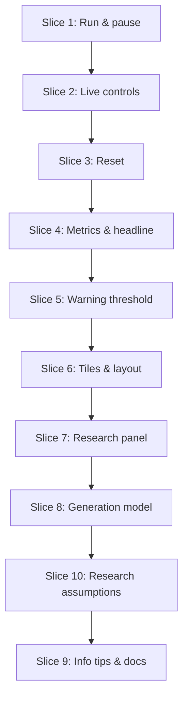

# Plan: AI vs. Human Code Review Simulator

**Created**: 2026-10-12 (rewritten after the research amendment; revised after plan review; revised for Vite build)
**Amended**: 2026-10-12, the generation amendment (revised after plan review round 1). This revises an implemented plan: Slices 1–7 are built; Slices 8, 10, and 9 (in that order) implement the amendment and update the tests for the revised Slice 1–7 scenarios.
**Branch**: `feat/ai-review-sim`
**Status**: approved
**Gherkin persistence**: features
**Spec**: `docs/specs/ai-vs-human-code-review-simulator.md` (amended 2026-10-12, including the generation amendment)

## Goal

Build a Vite + React app whose `npm run build` output is one self-contained offline file, `dist/index.html`, that simulates a human lane and an AI lane of code review. The rules come from published research. Each lane writes code at a set rate (LOC per work hour). The human lane's PR frequency (PRs per 8-hour work day) is set directly, so its PR size follows: code written × 8 ÷ PRs per day. The AI lane follows Faros AI's data: its PRs are 1.51× the human PR size, and its default code written gives 1.162× the human PR merge rate. Human reviewers read at a set speed (LOC per work hour) and skim AI code faster. Defect catching falls past 200 LOC and past 500 LOC/hr. Escaped defects become incidents. The defaults model one developer, so no queue grows at first; the presenter raises the AI lane's code written to show review falling behind. A live headline readout shows AI incidents per PR at about 3.65× the human lane's. That ratio is an outcome of the model, not a hard-coded label. Every slider has an info tip that explains it. A collapsible panel presents the verified research with citations and states the modeling assumptions plainly. Vitest unit tests cover the pure engine. Playwright tests cover every user-visible behavior against the built page.

**Approach stances** (from `knowledge/decision-defaults.md`):

- **Scope:**
  - Original build: create `src/engine.js`, `src/research.js`, `src/components/**`, and `e2e/*.spec.js`; replace the Vite demo; edit `vite.config.js`, `index.html`, `src/index.css`, `src/main.jsx`, `package.json` (feature dependencies only), and `CLAUDE.md`.
  - Generation amendment: **amend this plan in place**. Edit `src/**`, `e2e/**`, and `CLAUDE.md`; add `src/openTip.js`, `src/components/InfoTip.jsx`, `src/components/useOpenTip.js`, `e2e/generation.spec.js`, and `e2e/info-tips.spec.js`; change `tools/gherkin-sync/**` only in Step 8.0 (the `@wip` tag). The scenarios in `features/ai-vs-human-code-review-simulator/` are regenerated from this plan with `plan_gherkin_export.py`.
  - Do not touch `crt.html`, the `.mermaid` files, `sim.spec.md`, `before-value-stream.html`, or the toolchain configs from project-init.
- **Integration:** commit on `feat/ai-review-sim`. Use a PR with auto-merge once a remote exists. Never merge directly to `main` without being asked.
- **Replace vs. merge:** the generation amendment **replaces** the old generation model (PRs/hr sliders, the PR-size slider, and the 1.51 multiplier on that slider). There is no feature toggle and no data migration: this is a single-user offline demo with no saved state. Step 8.2 is purely additive (the new slider keys, the derived functions, and the reducer handling, under unit tests, while `laneParams` still reads the old keys); Step 8.3 flips `laneParams` to the new keys in the same commit as the UI cutover and removes the old keys, so no commit ships a control that does nothing.

**Out of scope:** charts and history graphs, saving settings, backend, auth, runtime CDN loading of any kind, TypeScript, per-lane thresholds, separate reviewer pools per lane, a team-size control, a review-capacity marker, a change to the elapsed caption, hard-coding any research ratio (3×, 4.6×) into the math, re-deriving the AI code-written slider when the human sliders change, and correcting tick timing for elapsed time.

## Preconditions (entry gate for `/build`)

- [x] `git init`, baseline commit `df30ed1` on `main`, branch `feat/ai-review-sim`.
- [x] Toolchain scaffolded by project-init (`83dbb30`). It provides:
  - Vite 8 and React 19.
  - oxlint, ESLint 9 (`lint:deep`), and Prettier.
  - Vitest (with `@vitest/coverage-v8`), plus Playwright 1.64 with Chromium.
  - Husky with lint-staged; pre-push runs `lint:deep`, `npm test`, and `npm run test:e2e`.
  - All of `lint`, `lint:deep`, `format:check`, `test`, and `test:e2e` pass.
- [x] Slices 1–7 built; `tools/gherkin-sync` fails the e2e run when a scenario test's `test.step` titles drift from its Gherkin.

## Acceptance Criteria

From the amended spec:

- [ ] AC1: On page load, the simulation is paused and all counts show 0.
- [ ] AC2: Start begins the simulation. The button then reads Pause, and pressing it stops all count changes.
- [ ] AC3: Reset sets all counts and metrics to 0 and pauses. Slider values do not change.
- [ ] AC4: Each slider shows its value with units and uses the default, range, and step from the State table: Human code written 30 (5–200, step 5), Human PRs per day 1 (0.25–4, step 0.25), AI code written 53 (5–2,000, step 1), Reviewer speed 300 (100–1000, step 50), AI skim multiplier 2 (1–3, step 0.5), Warning threshold 15 (5–50, step 1).
- [ ] AC5: After a slider change while running, the next tick's displayed counts reflect the new value, and the simulation keeps running.
- [ ] AC6: The warning-threshold slider (5–50, default 15) applies to both lanes.
- [ ] AC7: With the defaults, after 10 s:
  - Human: 0 pending, 1 deployed, 65%, 2 incidents, 1.69 per PR, 0.0 h wait.
  - AI: 0 pending, 1 deployed, 15%, 9 incidents, 6.16 per PR, 0.0 h wait.
  - Headline "3.65×".
- [ ] AC7a: At the defaults, AI incidents per PR is 3×–4× human incidents per PR.
- [ ] AC7b: Defects caught follows the size and speed factors: 80% at a human PR size ≤ 200 (speed 300); 4% at a human PR size ≥ 400; 22% at a human PR size of 200 and speed 900; AI lane 5% at skim 3× and 18% at skim 1×.
- [ ] AC7c: Changing Human code written, Human PRs per day, or reviewer speed while running changes defects caught and incident accrual from the next tick. Changing AI code written changes only the AI lane's PRs per day and its pending queue, never either lane's PR size or defects caught.
- [ ] AC7d: When AI code written exceeds the AI lane's effective review speed, the AI lane's internal pending LOC grows by (code written − effective speed) × 0.1 every tick (Vitest); at 1,000 LOC/hr the displayed Pending LOC strictly increases every tick (e2e) and it passes the default threshold (Pending Review 16 after 15 s). At 600 LOC/hr the queue stays at 0.
- [ ] AC8: A queue never shows a negative value.
- [ ] AC9: Deployed never decreases while running.
- [ ] AC10: Every count shows `Math.floor(x + 1e-9)` of its internal value (so 9.9999999999 shows 10, and 0.9 shows 0).
- [ ] AC11: A queue box warns when its displayed pending PRs are greater than the threshold, and clears at or below it. This applies to both lanes.
- [ ] AC12: The queue box shows `min(displayed, C)` tiles. C is exposed as `data-capacity`, between 22 and 98. When displayed > C, the box shows "+N more" with N = displayed − C.
- [ ] AC13: The Human lane has a blue `#3b82f6` accent, green Deployed, and `user`/`eye` icons. The AI lane has a purple `#a855f7` accent and `bot`/`eye` icons. The warning state is red `#ef4444`. At md (≥ 768px) and wider, each lane reads inputs → Pending Review → review side, left to right.
- [ ] AC14: The header shows "AI vs. Human Code Review Simulator" and "Watch AI-speed code generation swamp human reviewers and push more defects into production." At md and wider, the Start/Pause and Reset buttons sit to the right of the title. Below md, they sit on their own row.
- [ ] AC15: Page background `rgb(11, 13, 18)`. At 375 × 667 (below md = 768px), there is no horizontal scroll, the lanes stack, and Start/Pause and Reset are visible without scrolling. At 1280 × 720, the header, the headline, and both lanes' counts and metric grids are visible without scrolling.
- [ ] AC16: Sliders have visible labels, and every slider, info button, and button works with the keyboard. Tab order runs Start, Reset, then each slider's info button followed by its slider, then the research toggle.
- [ ] AC17: Each lane shows pending LOC, "Defects caught" %, incidents, incidents per PR, and pickup wait.
- [ ] AC18: A collapsible research panel (collapsed by default) shows the five findings from the spec's Research Sources table. It uses the Panel wording column verbatim (the Faros finding now includes "PR merge rate +16.2%"), except the practitioner-observation finding, which uses its quoted paraphrase. It links each source URL and never contains "near zero", "coined", or "originated". Its "Model assumptions" note lists the defect density, the base detection rate, the detection floors, the curve thresholds, and the human-lane defaults as modeling choices, and says the AI lane's PR size and default code written come from Faros.
- [ ] AC19: Hiding the tab while running auto-pauses the simulation.
- [ ] AC20 (revised): `npm run build` produces `dist/index.html` with no `<script src>`, no `<link rel="stylesheet">`, no `modulepreload`, and no `<link rel="icon">` pointing at a file. Opened from `file://`, it renders and runs and makes no request other than the document itself (`data:` URIs allowed). No page in any e2e spec requests an external host.
- [ ] AC21: A headline readout shows the live AI ÷ Human incidents-per-PR ratio (`toFixed(2)` + "×", e.g. "3.65×"), or "—" until both lanes *display* Deployed ≥ 1.
- [ ] AC22: An elapsed work-hours readout with a "1 s = 1 work hour" note, reset to 0.0 by Reset.
- [ ] AC23: Each lane shows its derived PR size as read-only text with its basis: Human "PR size 240 LOC (derived)"; AI "PR size 362 LOC (1.51× human)", "1.17 PRs/day (derived)", and "Effective speed 600 LOC/hr" at the defaults. Each updates when a slider it depends on changes.
- [ ] AC24: AI PR size is always human PR size × 1.51. Changing the human code written or PRs per day changes both lanes' PR sizes. Changing AI code written changes AI PRs per day and leaves both PR sizes unchanged.
- [ ] AC25: Every slider has an info button directly after its label, with the accessible name "About <slider label>" and an Info icon.
- [ ] AC26: Hovering the info button, or giving it keyboard focus, shows the tip. The tip sits directly against its button (no gap), so the pointer can move onto it and it stays open. Unless pinned by a click, tap, Enter, or Space, it closes when the pointer and focus both leave; Escape always closes it without moving the pointer. Opening one tip closes any other. The open/close truth table in the plan's Design decisions is the full rule.
- [ ] AC27: The tip text is the slider's accessible description. It names what the slider controls, its unit, and the lanes it affects, and contains none of the "do not use" wording ("near zero", "coined", "originated").
- [ ] AC28: With any tip open, the page has no horizontal scroll at 320 px and 375 px, and the open tip lies fully inside the viewport (all four edges). At 1280 × 720 the closed tips change no layout.

## Design decisions (fixed for the build)

### File structure and build

| Module | Contents |
| --- | --- |
| `src/engine.js` | Pure, with no React or DOM: constants, including `WORK_HOURS_PER_DAY = 8`, `FAROS_PR_SIZE_INCREASE_PCT = 51`, `FAROS_MERGE_RATE_INCREASE_PCT = 16.2`, and the derived `FAROS_PR_SIZE_MULTIPLIER = 1 + 51/100` and `FAROS_MERGE_RATE_MULTIPLIER = 1 + 16.2/100` (defined once; every displayed "+51%", "+16.2%", "1.51×", and "1.162×" comes from them). The numeric lane model `LANE_MODELS` (`locSetting`, `sizeMultiplier` — human 1, AI `FAROS_PR_SIZE_MULTIPLIER` — and `skimApplies`), the slider table (min/max/step/default), `humanPrSize(settings)`, `sizeFactor`, `speedFactor`, `detection`, `laneParams(settings, laneModel) → {gen, size, effSpeed, prsPerDay}`, `tick`, `isOverThreshold`, `emptyLane`, `MODEL_ASSUMPTIONS`, and the formatters, including `formatPrSize` and `formatPrsPerDay`. `laneParams` is the only caller of `humanPrSize`. Unit-tested by `src/engine.test.js` (Vitest). An ESLint `no-restricted-imports` override forbids it from importing `react`, `lucide-react`, `./components/*`, or `./laneConfig*`. |
| `src/reducer.js` | Pure `reducer(state, action)` and `initialState`: `tick`, `start`, `pause`, `reset`, `setSetting`. Unit-tested by `src/reducer.test.js` (Vitest). |
| `src/openTip.js` | Pure `openTipReducer(state, event)` and `isTipShown(state, key)` for the info-tip truth table below. Unit-tested by `src/openTip.test.js`, one test per truth-table row. Same ESLint purity rule as the engine. |
| `src/laneConfig.js` | Presentation only: labels, units, spoken units, **info-tip text** (`SLIDER_PRESENTATION[key].info`, `.unitName`, `.lanes`), the derived fields each lane shows, icon names, and complete Tailwind class-string literals per lane, plus the tile layout. Tip text is built from `WORK_HOURS_PER_DAY` and the Faros constants in `engine.js`, never literal numbers. |
| `src/research.js` | The findings array and the assumptions note, built from `engine.MODEL_ASSUMPTIONS` and the Faros constants. |
| `src/components/` | `Header`, `HeadlineBand`, `Lane`, `QueueBox`, `LaneMetrics`, `MetricValue`, `RateSlider`, `InfoTip` (props: `id`, `label`, `text`), `useOpenTip` (a hook over `openTipReducer` that owns the open tip, the Escape listener, and the hover/focus bookkeeping), `ResearchPanel`, and `Icon`. `Icon` maps an explicit set of **six** names (`user`, `bot`, `eye`, `triangle-alert`, `chevron-down`, `info`) in `iconMap.js` to named `lucide-react` imports, never `icons[name]`, so tree-shaking keeps the bundle small. It adds the `data-icon` hook. `Lane` has no lane-specific model branching: it renders the derived fields listed for its lane in `laneConfig.js` from `laneParams`. |
| `src/App.jsx` | `useReducer(reducer, initialState)`, the interval and visibility effects, `useOpenTip()` (its handlers reach every `InfoTip` through a small context), and the layout. |
| `src/main.jsx` | Mounts `App` and imports `index.css`, which holds the Tailwind 4 `@import "tailwindcss"` and the palette `@theme` tokens. |

**Build:**

- `vite.config.js` adds `@tailwindcss/vite` and `vite-plugin-singlefile`, so `npm run build` emits one `dist/index.html` with inlined JS and CSS.
- `index.html` gets the title "AI vs. Human Code Review Simulator". The `<link rel="icon" href="/favicon.svg">` is removed, and `public/` (favicon and icon sprites) is deleted, because nothing may be fetched besides the document.
- `playwright.config.js`: `reuseExistingServer: false`, so every e2e run builds fresh; the `tools/gherkin-sync` reporter checks scenario steps.
- `e2e/fixtures.js`: a shared Playwright `test` fixture that records every request on the page. After each test it asserts there were no external-host requests. For `file://` pages, the only allowed requests are the document URL plus `data:` and `blob:` URIs. Every spec imports `test`/`expect` from it.

**Feature dependencies** (exact versions recorded by `npm install` in `package-lock.json`):

- runtime: `lucide-react`
- dev: `tailwindcss` 4, `@tailwindcss/vite`, `vite-plugin-singlefile`

Step 1.1 asserts that the icons `User`, `Bot`, `Eye`, `TriangleAlert`, and `ChevronDown` exist in the installed `lucide-react`; Step 9.1 adds `Info`.

### State and engine

- **State:** one `useReducer` in `App` holds settings, both lanes, `ticks`, and `isRunning`. The interval depends only on `isRunning` and dispatches `{type:'tick'}`. The reducer reads the current settings, so AC5 and AC7c need no extra mechanism. The info-tip state is UI state in `useOpenTip`, not reducer state.
- **Settings** (generation amendment):
  - `humanLocPerHour` 30 (5–200, step 5)
  - `humanPrsPerDay` 1 (0.25–4, step 0.25)
  - `aiLocPerHour` 53 (5–2000, step 1). The default is `round(30 × FAROS_PR_SIZE_MULTIPLIER × FAROS_MERGE_RATE_MULTIPLIER)` = round(52.64); a unit test pins that derivation.
  - `reviewerSpeed` 300 (100–1000, step 50)
  - `skim` 2 (1–3, step 0.5)
  - `threshold` 15 (5–50)
- **Derived parameters** (unrounded in the model):
  - `humanPrSize(settings) = humanLocPerHour × WORK_HOURS_PER_DAY ÷ humanPrsPerDay` (240 at the defaults).
  - `laneParams(settings, laneModel)`:
    - `size = humanPrSize(settings) × laneModel.sizeMultiplier` (Human 240, AI 362.4)
    - `gen = settings[laneModel.locSetting] ÷ size` PRs per work hour
    - `prsPerDay = gen × WORK_HOURS_PER_DAY` (Human 1, AI 1.17)
    - `effSpeed = reviewerSpeed × (skimApplies ? skim : 1)`
  - `tick`, `LaneMetrics`, and the derived read-only text all use `laneParams`.
- **Order inside `tick`** (unchanged):
  1. Generate `gen × 0.1` PRs of `size` LOC.
  2. Compute `avgSize = pendingPrs > 1e-9 ? pendingLoc / pendingPrs : size`.
  3. Compute `d = detection(avgSize, effSpeed)`.
  4. Review: `reviewedLoc = min(pendingLoc, effSpeed × 0.1)`, and `reviewedPrs = pendingLoc > 1e-9 ? pendingPrs × reviewedLoc / pendingLoc : 0`.
  5. Escape: add `reviewedLoc × 0.02 × (1 − d)`.
  6. Clamp pending to ≥ 0.
  7. `ticks += 1` (in the reducer).
- **Displayed "Defects caught"** uses `detection(size, effSpeed)` from the current settings, as the spec says. Accrual uses `avgSize`, so the two can differ briefly after a mid-run size change while the queue holds mixed sizes (see Risks).

### Display

- **Counts:** `floorShow(x) = Math.floor(x + 1e-9)`.
- **Derived PR size:** `formatPrSize(size)` = `Math.round`, en-US separators, + " LOC" ("PR size 1,450 LOC"). Basis: Human "(derived)"; AI "(1.51× human)" from `FAROS_PR_SIZE_MULTIPLIER`.
- **AI PRs per day:** `formatPrsPerDay(prsPerDay)` = `toFixed(2)` + " PRs/day", then "(derived)". Vitest pins "0.58" and "1.17".
- **Defects caught:** `Math.round(d × 100)` + "%".
- **Incidents per PR:** `toFixed(2)`. Shows "—" while the *displayed* Deployed is 0.
- **Pickup wait:** `pendingLoc ÷ effSpeed`, shown with `toFixed(1)` + " h".
- **Pending LOC:** en-US thousands separators.
- **Headline:** `(aiEsc/aiDp) ÷ (humanEsc/humanDp)` from internal values, `toFixed(2)` + "×". Shows "—" until both lanes display Deployed ≥ 1.
- **Elapsed:** `(ticks × 0.1).toFixed(1)` + " work hours", with the caption "1 s = 1 work hour" (unchanged).
- **Warning:** the number, the tiles, and `isOverThreshold(displayed, threshold)` all use one `displayed` pending-PR value.

### Layout

**Header:**

- Title "AI vs. Human Code Review Simulator".
- Description, exact text: "Watch AI-speed code generation swamp human reviewers and push more defects into production."
- Start/Pause, Reset (with a visible gap from Start/Pause), the Running/Paused status, the elapsed readout, and the threshold slider.

**Headline band:** sits between the header and the lanes. It holds the large AI ÷ Human ratio with the text "more incidents per PR from AI-generated code".

**Lanes:** the Human lane is on top and the AI lane below, per spec §5. Each lane reads left → middle → right:

| Lane | Left | Middle | Right |
| --- | --- | --- | --- |
| **Human** | "Human code written (LOC/hr)", "Human PRs per day", and derived text "PR size 240 LOC (derived)" | Pending Review box (PRs + LOC) | "Reviewer speed (LOC/hr, both lanes)" and the metrics grid |
| **AI** | "AI code written (LOC/hr)" and derived text "PR size 362 LOC (1.51× human)" and "1.17 PRs/day (derived)" | Pending Review box | "AI skim multiplier" slider, derived text "Effective speed 600 LOC/hr", and the metrics grid |

- Derived values are plain text, never slider-styled. "Effective speed" keeps its small "derived" tag.
- Every slider label is followed by its info button (see Info tips).
- **Metrics grid:** identical in both lanes, with fixed row order: Deployed, Defects caught, Incidents, Incidents per PR, Pickup wait. It has the same column width in both lanes, so the rows line up vertically.

### Info tips

- `InfoTip({id, label, text})` renders a native `<button type="button">` (at least 24 × 24 px, WCAG 2.5.8) with `aria-label="About <label>"` and the `info` icon, directly after the slider's `<label>`, plus a tip element with `role="tooltip"` and `id`. The tip is always in the DOM (`hidden` when closed, so it takes no space), and the slider's `<input>` has `aria-describedby={id}`, so the tip text is the slider's accessible description even when no tip is open (AC27).
- **Look:** `text-base`, light text on a dark surface with at least 4.5:1 contrast, and a visible border. The tip opens **above the label row**, so it never covers the slider it describes; the header's threshold tip, which sits near the top of the page, opens **below its slider** instead. The tip's edge touches its button, with no gap. If there is no room above (the tip's top would be above the viewport's top edge, measured when it opens), the tip flips below the label row; either way it lies fully inside the viewport on all four edges (AC28). It is absolutely positioned and spans the slider column's width (`left-0 right-0`), so it never extends past the viewport at 320 px and moves no other element (AC28).
- **Open/close truth table** (`openTipReducer`; one tip is shown at a time; a tip K is shown when K is the active tip, K is not dismissed, and K is hovered, keyboard-focused, or pinned):

| Event on tip K | Result |
| --- | --- |
| Mouse pointer enters K's button or tip | K becomes active and hovered; dismissal is cleared; K is shown and any other tip is hidden and unpinned. |
| Mouse pointer leaves K's button and tip | K is no longer hovered; K stays shown only if its button has keyboard focus or K is pinned. |
| Keyboard focus reaches K's button (`:focus-visible`) | K becomes active and focused; dismissal is cleared; K is shown and any other tip is hidden and unpinned. |
| K's button loses focus | K is no longer focused; K stays shown only if it is hovered or pinned. |
| Click, tap, Enter, or Space on K's button, K shown and not pinned | K becomes pinned and stays shown, so it survives the pointer leaving and the button losing focus. |
| Click, tap, Enter, or Space on K's button, K pinned | K is hidden (dismissed, unpinned). |
| Click, tap, Enter, or Space on K's button, K hidden | K becomes active and pinned, and is shown; any other tip is hidden and unpinned. |
| Pointer down outside K's button and tip, K pinned | K is unpinned and hidden (dismissed). |
| Escape, anywhere, while K is shown | K is always dismissed and unpinned, so it is hidden. Focus and the pointer do not move. |
| Reopen after Escape or a closing click | The mouse pointer leaving and re-entering, keyboard focus leaving and returning, or another click shows K again. |

  Hover means a mouse pointer (`pointerType === 'mouse'`); a touch tap works through the click rows only. Pointer-initiated focus does not open the tip by itself. Safari and touch browsers don't focus a button on click, so the outside-pointer-down row is how a pinned tip closes there. `useOpenTip` adds the `document` Escape and `pointerdown` listeners only while a tip is shown and removes them when the tip closes and on unmount.

- **Tip text** (`SLIDER_PRESENTATION[key].info`). Each tip leads with one plain sentence of at most 25 words that names what the slider controls and its unit; the lanes it affects and any source follow. Numbers come from `WORK_HOURS_PER_DAY` and the Faros constants. Research claims use only the spec's Panel wording:

| Slider | Unit / lanes (Vitest) | Tip text |
| --- | --- | --- |
| Warning threshold | "PRs" / "both lanes" | "A Pending Review box turns red when its count is above this many PRs, in both lanes." |
| Human code written (LOC/hr) | "LOC/hr" / "human lane" | "How many lines of code the human lane writes, in LOC/hr. With Human PRs per day, it sets the human PR size. AI PRs are 1.51× that size (Faros: PR size +51%)." |
| Human PRs per day | "PRs/day" / "human lane" | "How many PRs the human lane opens per 8-hour work day, in PRs/day. Below 1, a PR spans more than one day. Human PR size = LOC/hr × 8 ÷ PRs/day." |
| AI code written (LOC/hr) | "LOC/hr" / "AI lane" | "How many lines of code the AI lane generates, in LOC/hr. The AI queue grows once this exceeds the AI lane's effective review speed. Default: the human default scaled by Faros (PR size +51%, PR merge rate +16.2%)." |
| Reviewer speed (LOC/hr, both lanes) | "LOC/hr" / "both lanes" | "How many lines of code a reviewer reads, in LOC/hr, in both lanes. Defect discovery drops significantly faster than 500 LOC/hour (SmartBear)." |
| AI skim multiplier | "×" / "AI lane" | "How much faster reviewers read AI-generated code (×) in the AI lane: effective speed is reviewer speed × this value. AI PRs are reviewed 2× faster once picked up (LinearB)." |

### Projector fit and type

At 1280 × 720 with the panel collapsed and every tip closed, the header, the headline band, and both lanes' Pending Review counts and metrics grids are visible without scrolling. Step 9.1 re-verifies this with the info buttons in place.

| Element | Minimum size |
| --- | --- |
| Headline ratio | `text-6xl` |
| Counts | `text-4xl` |
| Metric values | `text-xl` |
| Labels and tips | `text-base` |

### Narrow layout (< `md`)

- The lanes stack.
- Inside a lane: inputs, then Pending Review, then the review side and metrics.
- The header wraps, with the buttons on their own row. They stay visible at 375 × 667.

### Look, accessibility, and test hooks

- **Palette:**
  - Human: blue accent `#3b82f6`, green Deployed.
  - AI: purple accent `#a855f7`.
  - Warning: red `#ef4444`.
  - Background `#0b0d12`.
- **Terminology:** "Pending Review", "Deployed", "Defects caught", "Incidents", "Incidents per PR", "Pickup wait", "Code written", "PRs per day", "PR size".
- **Screen readers:** counts have no `aria-live`. A per-lane `role="status"` element announces only "<Lane> Pending Review over threshold". Info tips use `role="tooltip"` and `aria-describedby`.
- **Test hooks** (and nothing else): `data-lane="human|ai"`, `data-accent`, `data-icon="<name>"` on each `Icon`, `data-tile` on each tile, `data-metric="<name>"` on each metric value, `data-state="warning|normal"`, `data-capacity`, and `#slider-value-<key>`.
  - Accent, warning, and focus colors are asserted through computed style.
  - The focus ring is asserted as a non-`none` `outline-style` on `:focus-visible`.
  - Tips are found by `role="tooltip"` and through the slider's accessible description.

### Page behavior

- **Auto-pause:** a `visibilitychange` event with `visibilityState === 'hidden'` dispatches `pause`. Becoming visible again does nothing.
- **Research panel:** a `<details>`/`<summary>` element, collapsed by default.
  - Its text comes verbatim from the spec's Research Sources "Panel wording" column, with links to the five URLs (`target="_blank" rel="noopener"`). The Faros finding reads "Across 22,000 developers in 4,000 teams, high AI adoption saw PR size +51%, PR merge rate +16.2%, and 3× incidents per PR (+242.7%), compared with low adoption.", with +51% and +16.2% taken from the engine constants.
  - Its "Model assumptions" note, built from `MODEL_ASSUMPTIONS`: "Model assumptions. These are modeling choices, not research findings: the defect density (20 defects per 1,000 LOC), the base detection rate (0.8, picked from SmartBear's 70–90% range), the detection floors (0.05 for large PRs and 0.1 for fast reviewing), the curve thresholds (PR size 200 to 400 LOC, reviewer speed 500 to 1,000 LOC/hr), and the human-lane defaults (30 LOC/hr and 1 PR per day). The AI lane's PR size (1.51× the human PR size) and default code written (1.162× the human PR merge rate) come from Faros." Then: "The human defaults were chosen to land near" + the link "Faros's +242.7% incidents per PR".
  - The phrases "near zero", "coined", and "originated" never appear.

## Slices

Every slice edits `src/App.jsx`, `src/components/**`, or shared e2e files, so the slices run in sequence: 1–8, then 10, then 9.

**History note:** Slices 1–7 are built. Their Gherkin below is the **revised** contract after the generation amendment. Their step bodies record what was built under the old model and are not re-run; the work that makes the built code and tests match the revised scenarios lives in Slices 8, 10, and 9 (each such step names the `@wip` scenarios it clears).

**Test approach (all slices):**

- **Engine (Vitest, `src/engine.test.js`, `src/reducer.test.js`, `src/openTip.test.js`):** every numeric scenario is first pinned as a pure-function test of `tick`, `detection`, `laneParams`, and the formatters. This is fast and has no browser.
- **UI (Playwright, `e2e/*.spec.js`):**
  - Playwright's `webServer` builds and serves `dist/` (`vite preview`).
  - Each test calls `page.clock.install()` before `goto('/')`, waits for the header title, then calls `page.clock.pauseAt(now)`. Time then advances only through `runFor`; one tick is `runFor(100)`.
  - Tests find elements by role and accessible name, scoped by `data-lane`. They read visible text, ARIA attributes, the test hooks, or computed style.
  - Each scenario test wraps every Gherkin step in `test.step('<exact step line>', …)`; `tools/gherkin-sync` checks them.
- **`@wip` scenarios (generation amendment):**
  - Every new or revised scenario below is tagged `@wip`. Step 8.0 teaches `tools/gherkin-sync` to skip `@wip` scenarios in both the step check and the completeness check and to print how many are pending; with `GHERKIN_SYNC_STRICT=1` it fails when any `@wip` scenario remains. Drift in any untagged scenario still fails the run.
  - A step that implements scenarios removes their `@wip` tags in this plan and re-exports with `python3 <dev-team plugin>/scripts/plan_gherkin_export.py plans/ai-vs-human-code-review-simulator.md`. Each step lists the tags it clears.
  - While a scenario is `@wip`, its existing e2e test may be marked `test.fixme` with a `// @wip: Step N.M` comment if the cutover (Step 8.3) or the info buttons (Step 9.1) break it; the clearing step reworks it and removes the `fixme`. A step's "full suite green" means: Vitest green, every non-`fixme` Playwright test passing, and a clean Gherkin-sync report apart from the `@wip` count.
  - The Pre-PR gate runs the e2e suite with `GHERKIN_SYNC_STRICT=1` and a grep that finds no `test.fixme` in `e2e/`.
- Slider labels below are the accessible names.

**Default arithmetic** (generation amendment):

- **Human (defaults):** 30 LOC/hr at 1 PR/day → PR size 240 LOC, 0.125 PR/hr (0.0125 PR and 3 LOC per tick). Review capacity is 30 LOC per tick, so pending stays 0. `d = 0.8 × sizeFactor(240) = 0.8 × 0.81 = 0.648` → 65%. Incidents per PR = 240 × 0.02 × 0.352 = 1.6896 → 1.69. Deployed reaches 1 at tick 80 (8.0 s; 0.9875 at 7.9 s).
- **AI (defaults):** 53 LOC/hr, PR size 362.4, 0.14625 PR/hr. Effective review is 600 LOC/hr, so pending stays 0. `d = 0.8 × 0.2286 × 0.82 = 0.14996` → 15%. Incidents per PR = 362.4 × 0.02 × 0.85004 = 6.161 → 6.16. Headline 6.161 ÷ 1.6896 = 3.65×. At 10 s: Human 1.25 deployed, 2.112 incidents; AI 1.4625 deployed, 9.010 incidents.
- **Mid-run changes from the defaults at 1 s (AC7c):**
  - "Human PRs per day" → 0.25: human PR size 960, so the next tick shows Defects caught 4%; at 10 s the Human lane shows Incidents 5 (5.395) and Deployed 0 (0.406), so Incidents per PR is "—" (default run: 2 incidents).
  - "Reviewer speed" → 900: the next tick shows Human Defects caught 18% (0.8 × 0.81 × 0.28 = 0.181); at 10 s the Human lane shows Incidents 4 (4.631) and Incidents per PR 3.71.
  - "Human code written" → 50: PR size 400, next tick 4%; at 10 s Incidents 8 (8.851) and Incidents per PR 7.08.
- **Busy AI (`AI code written` 2000, everything else default):** +0.55188 PR (200 LOC) per tick generated, 60 LOC = 0.16556 PR reviewed, so AI pending grows by 0.38631 PR per tick. Pending (internal → displayed): 1 s 3.863 → 3; 2 s 7.726 → 7; 3 s 11.589 → 11; 3.8 s 14.680 → 14; 3.9 s 15.066 → 15; 4.2 s 16.225 → 16; 5 s 19.316 → 19; 5.7 s 22.020 → 22; 6 s 23.179 → 23; 10 s 38.631 → 38; 30 s 115.894 → 115. AI deployed: 1 s 1.656 → 1; 3 s 4.967 → 4.
- **AI at 1,000 LOC/hr:** pending LOC grows by exactly 40 per tick (40, 80, 120, …, 6,000 at 15 s), so the displayed Pending LOC strictly increases; pending PRs 11 at 10 s and 16 (16.556) at 15 s, first ≥ 16 at tick 145. **AI at 600 LOC/hr:** pending stays 0 for at least 30 s; deployed 16 (16.556) at 10 s.
- **Exact AI preset (`Human code written` 5, `Reviewer speed` 100, `AI skim multiplier` 1, `AI code written` 704):** human PR 40 LOC, AI PR 60.4 LOC; the AI lane generates 1.16556 PR and reviews 0.16556 PR per tick, a net of exactly +1 PR per tick. Displayed AI Pending Review is n after n ticks for every n ≤ 100 (checked).
- **Human backlog preset (`Human code written` 200, `Human PRs per day` 4, `Reviewer speed` 100):** human PR 400 LOC; +0.05 PR generated and 0.025 PR reviewed per tick, so human pending grows by one PR every 4 s (6 at 24 s). With `AI code written` 2000 and skim 2 (effective 200 LOC/hr), AI pending is 71 at 24 s.
- **Derived display:** at 0.5 PRs/day, 480 / 724.8 → "725" / 0.585 → "0.58"; at 0.25, 960 / 1,449.6 → "1,450" / "0.29"; at 35 LOC/hr and 0.75, 373.3 → "373" / 563.7 → "564" / "0.75"; AI at 2000 LOC/hr, "44.15".

The reference implementation runs the real `src/engine.js` `tick` with these parameters (scratchpad `amend.mjs` plus `a1`–`a5.mjs`, 2026-10-12). Every number in the scenarios below was produced by it. Unit tests pin them, so the scratchpad is not needed again.

### Slice 1: Two lanes that run and pause

**Depends-on:** none
**Files:** `vite.config.js`, `index.html`, `package.json`, `package-lock.json`, `playwright.config.js`, `eslint.config.js`, `public/**`, `src/**`, `e2e/fixtures.js`, `e2e/run-pause.spec.js`, `e2e/example.spec.js`

**Behavior:**

```gherkin
Feature: Run and pause the simulation

  Scenario: Page loads paused with empty lanes
    Given I open the simulator
    Then both lanes show Pending Review 0 and Deployed 0
    And the Start/Pause button reads "Start"
    And the status reads "Paused"
    And the elapsed readout shows "0.0 work hours" with the caption "1 s = 1 work hour"

  Scenario: Header content
    Given I open the simulator
    Then the header shows the title "AI vs. Human Code Review Simulator"
    And the header shows "Watch AI-speed code generation swamp human reviewers and push more defects into production."
    And the Start/Pause and Reset buttons follow the title in reading order

  Scenario: Lane identity
    Given I open the simulator
    Then the Human lane has a "user" icon at generation, an "eye" icon at review, and a blue accent
    And the AI lane has a "bot" icon at generation, an "eye" icon at review, and a purple accent

  Scenario: Nothing moves while paused
    Given I open the simulator
    When 5 seconds pass without pressing Start
    Then both lanes still show Pending Review 0 and Deployed 0
    And the elapsed readout shows "0.0 work hours"

  Scenario: Start switches the button to Pause
    Given I open the simulator
    When I press Start
    Then the Start/Pause button reads "Pause" and the status reads "Running"

  Scenario: Default flow after 10 seconds
    Given I open the simulator
    When I press Start and 10 seconds pass
    Then the Human lane shows Pending Review 0 and Deployed 1
    And the AI lane shows Pending Review 0 and Deployed 1
    And the elapsed readout shows "10.0 work hours"

  Scenario: A PR is not shown as deployed until it is fully reviewed
    Given I open the simulator
    When I press Start and 7.9 seconds pass
    Then the Human lane shows Deployed 0
    When 0.1 more seconds pass
    Then the Human lane shows Deployed 1

  Scenario: Pause freezes the counts
    Given I set "AI code written (LOC/hr)" to 2000 and the simulation is running and has run for 3 seconds
    When I press Pause and 5 more seconds pass
    Then the AI lane shows Pending Review 11 and Deployed 4
    And the elapsed readout shows "3.0 work hours"
    And the Start/Pause button reads "Start"

  Scenario: Resume continues from the frozen counts
    Given I set "AI code written (LOC/hr)" to 2000 and the simulation was paused after 3 seconds
    When I press Start and 1 second passes
    Then the AI lane shows Pending Review 15 and Deployed 6

  Scenario: Deployed never decreases while running
    Given I set "AI code written (LOC/hr)" to 2000 and press Start
    Then each lane's Deployed count, sampled every tick for 10 seconds, never decreases

  Scenario: Hiding the tab auto-pauses
    Given I set "AI code written (LOC/hr)" to 2000 and the simulation is running and has run for 1 second
    When the page becomes hidden
    And 3 seconds pass
    Then the status reads "Paused" and the AI lane still shows Pending Review 3

  Scenario: Showing the tab again stays paused
    Given I set "AI code written (LOC/hr)" to 2000 and the simulation auto-paused when the page became hidden after 1 second
    When the page becomes visible again
    And 2 seconds pass
    Then the status reads "Paused" and the AI lane still shows Pending Review 3

  Scenario: Hiding the tab while paused changes nothing
    Given I open the simulator
    When the page becomes hidden
    Then the status reads "Paused" and all counts show 0

  Scenario: The build is one self-contained file
    Given the project is built
    Then dist/index.html exists
    And it has no script element with a src attribute, no stylesheet link, no modulepreload link, and no icon link to a file
    And dist contains no other JS or CSS files

  Scenario: The built file runs from disk with no other requests
    Given the project is built
    When I open dist/index.html from the file system
    Then the header title is visible
    When I set "AI code written (LOC/hr)" to 2000, press Start, and 1 second passes
    Then the AI lane shows Pending Review 3
    And the only request made was for the document itself
```

**Steps:** (built under the old model; the `@wip` scenarios are cleared by Step 8.4)

#### Step 1.1: Replace the Vite demo with the styled static shell and offline single-file build

**Complexity**: standard
**IMPLEMENT**:

- Remove the Vite demo and the starter placeholders: `src/App.css`, `src/assets/**`, `public/icons.svg`, `src/index.js`, `src/index.test.js`, and `e2e/example.spec.js`.
- Add `lucide-react`, `tailwindcss` 4, `@tailwindcss/vite`, and `vite-plugin-singlefile`. Configure `vite.config.js`.
- `src/index.css`: `@import "tailwindcss"` plus the palette `@theme` tokens. `index.html` gets the title.
- `src/engine.js`: lane config and `laneParams` only.
- Components: `Header` (title, exact description, Start/Pause, Reset, status, elapsed), `HeadlineBand` showing "—", two config-driven `Lane`s with test hooks, and `Icon` wrapping `lucide-react` with `data-icon`.
**TEST**:
- Vitest: `laneParams` at the defaults.
- Playwright: page loads paused, header, lane identity, nothing moves while paused, and "the build is one self-contained file". The file is parsed for element attributes, not text-scanned for "http", which would false-fail on SVG `xmlns` and React strings. Add the shared `e2e/fixtures.js` external-request guard.
**REFACTOR**: Keep the numeric lane model and slider table in `src/engine.js`, and presentation config in `src/laneConfig.js`. The ESLint `no-restricted-imports` override keeps the engine pure.
**Files**: `vite.config.js`, `index.html`, `package.json`, `package-lock.json`, `playwright.config.js`, `eslint.config.js`, `public/**`, `src/**`, `e2e/fixtures.js`, `e2e/run-pause.spec.js`, `e2e/example.spec.js`
**Commit**: `feat(sim): offline single-file shell with paused lanes`

#### Step 1.2: Reducer, LOC-based tick, Start/Pause, and elapsed hours

**Complexity**: standard
**IMPLEMENT**:

- `src/reducer.js` (`initialState`, `start`/`pause`/`tick`) and the default settings (`laneParams` exists from Step 1.1).
- The pure `tick` with the full order above: generation, the avg-size guard, proportional review, and the clamp. Escape accrual is stubbed to `d = 0` until Step 4.2.
- The interval tied to `isRunning`, the Start/Pause toggle and status, `ticks`, and the elapsed readout.
**TEST**:
- Vitest: `tick` default flow at 10 s, partial PR through `floorShow`, clamp and empty-queue guard, `reducer` start, pause, and tick (and ticks not advancing while paused).
- Playwright: Start→Pause, default flow at 10 s, partial PR, pause freeze, resume, deployed never decreases, and "the built file runs from disk with no other requests".
**REFACTOR**: Clear the interval on pause and on unmount. Keep the reducer cases small.
**Files**: `src/**`, `e2e/run-pause.spec.js`
**Commit**: `feat(sim): LOC-based tick engine with start/pause and elapsed hours`

#### Step 1.3: Auto-pause on hidden tab

**Complexity**: standard
**IMPLEMENT**: Add a `visibilitychange` listener that dispatches `pause` only when hidden. Remove the listener on unmount.
**TEST**: The three hidden/visible scenarios. Tests override `document.visibilityState` and dispatch the event.
**REFACTOR**: Group the effect hooks (interval, visibility) together.
**Files**: `src/**`, `e2e/run-pause.spec.js`
**Commit**: `feat(sim): auto-pause when the tab is hidden`

### Slice 2: Live controls

**Depends-on:** 1
**Files:** `src/**`, `e2e/controls.spec.js`

**Behavior:**

```gherkin
Feature: Adjust the model live

  Scenario Outline: Controls start at their defaults with units
    Given I open the simulator
    Then the "<control>" slider has value <default>, min <min>, max <max>, and step <step>
    And its visible value reads "<shown>"

    Examples:
      | control                              | default | min  | max  | step | shown      |
      | Human code written (LOC/hr)          | 30      | 5    | 200  | 5    | 30 LOC/hr  |
      | Human PRs per day                    | 1       | 0.25 | 4    | 0.25 | 1 PRs/day  |
      | AI code written (LOC/hr)             | 53      | 5    | 2000 | 1    | 53 LOC/hr  |
      | Reviewer speed (LOC/hr, both lanes)  | 300     | 100  | 1000 | 50   | 300 LOC/hr |
      | AI skim multiplier                   | 2       | 1    | 3    | 0.5  | 2×         |
      | Warning threshold                    | 15      | 5    | 50   | 1    | 15 PRs     |

  Scenario: Derived PR sizes, AI PRs per day, and effective speed are read-only
    Given I open the simulator
    Then the Human lane shows "PR size 240 LOC (derived)"
    And the AI lane shows "PR size 362 LOC (1.51× human)", "1.17 PRs/day (derived)", and "Effective speed 600 LOC/hr"
    And none of the derived values is a slider
    When I set "Human PRs per day" to 2 and "AI skim multiplier" to 3
    Then the Human lane shows "PR size 120 LOC (derived)"
    And the AI lane shows "PR size 181 LOC (1.51× human)", "2.34 PRs/day (derived)", and "Effective speed 900 LOC/hr"

  Scenario Outline: Sliders stop at their bounds
    Given I open the simulator
    When I press <key> <presses> times on "<control>"
    Then the "<control>" slider has value <bound>

    Examples:
      | control                              | key        | presses | bound |
      | Human code written (LOC/hr)          | ArrowRight | 40      | 200   |
      | Human code written (LOC/hr)          | ArrowLeft  | 10      | 5     |
      | Human PRs per day                    | ArrowLeft  | 10      | 0.25  |
      | Human PRs per day                    | ArrowRight | 20      | 4     |
      | Reviewer speed (LOC/hr, both lanes)  | ArrowLeft  | 200     | 100   |
      | Reviewer speed (LOC/hr, both lanes)  | ArrowRight | 200     | 1000  |
      | AI skim multiplier                   | ArrowRight | 200     | 3     |
      | AI skim multiplier                   | ArrowLeft  | 200     | 1     |
      | Warning threshold                    | ArrowLeft  | 50      | 5     |
      | Warning threshold                    | ArrowRight | 50      | 50    |

  Scenario Outline: The AI code-written slider jumps to its bounds
    Given I open the simulator
    When I press <key> on "AI code written (LOC/hr)"
    Then the "AI code written (LOC/hr)" slider has value <bound>

    Examples:
      | key  | bound |
      | End  | 2000  |
      | Home | 5     |

  Scenario: A review-side change applies on the next tick
    Given I set "AI code written (LOC/hr)" to 2000 and the simulation is running and has run for 1 second
    And the AI lane shows Deployed 1
    When I set "Reviewer speed (LOC/hr, both lanes)" to 1000 and "AI skim multiplier" to 3
    And 0.1 seconds pass
    Then the AI lane shows Deployed 2
    And the Start/Pause button still reads "Pause"

  Scenario: A change while paused takes effect only after Start
    Given I set "AI code written (LOC/hr)" to 2000 and the simulation ran for 1 second and was paused
    And the AI lane shows Pending Review 3
    When I set "Reviewer speed (LOC/hr, both lanes)" to 100
    Then the AI lane still shows Pending Review 3
    When I press Start and 0.1 seconds pass
    Then the AI lane shows Pending Review 4

  Scenario: A backlog drains to zero and never below
    Given I set "AI code written (LOC/hr)" to 2000 and the simulation is running and has run for 2 seconds
    And the AI lane shows Pending Review 7
    When I set "AI code written (LOC/hr)" to 5 and "Reviewer speed (LOC/hr, both lanes)" to 1000
    And 2 seconds pass
    Then the AI lane shows Pending Review 0
    And the AI Pending Review count, sampled every tick, was never below 0

  Scenario: Sliders are keyboard operable
    Given I open the simulator
    When I Tab to "Reviewer speed (LOC/hr, both lanes)" and press ArrowRight
    Then that slider has value 350 and its visible value reads "350 LOC/hr"
```

**Steps:** (built under the old model; the `@wip` scenarios are cleared by Step 8.4)

#### Step 2.1: Labeled sliders, derived AI values, and live/paused changes

**Complexity**: standard
**IMPLEMENT**:

- Add a `RateSlider` component: a native range input, a `<label>` (the accessible name above), a visible value with units, and `aria-valuetext` with units.
- Add the sliders in their lane positions.
- Add the derived text from `laneParams`.
**TEST**: All scenarios. The engine needs no change, because the reducer already reads the current settings.
**REFACTOR**: Slider config comes from one table, matching the spec's State table.
**Files**: `src/**`, `e2e/controls.spec.js`
**Commit**: `feat(sim): live model controls with derived AI size and speed`

> Check (generation amendment): paused at 1 s with AI code written 2000, AI pending is 3.863 PRs. With reviewer speed 100 (effective 200), one tick adds 0.552 and reviews 0.055, giving 4.360, which displays 4. With reviewer 1000 and skim 3 the next tick reviews 300 LOC, so AI deployed goes 1.656 → 2.483 (displays 2). Draining from 7.726 with AI code written 5 and effective speed 2000 reaches 0 after 13 ticks and never goes below.

### Slice 3: Reset

**Depends-on:** 2
**Files:** `src/**`, `e2e/reset.spec.js`

**Behavior:**

```gherkin
Feature: Reset the simulation

  Scenario: Reset while running clears lanes and elapsed time, pauses, and keeps settings
    Given I set "AI code written (LOC/hr)" to 400 and "Human PRs per day" to 2
    And the simulation is running and has run for 3 seconds
    When I press Reset
    Then both lanes show Pending Review 0 and Deployed 0
    And the elapsed readout shows "0.0 work hours"
    And the Start/Pause button reads "Start"
    And "AI code written (LOC/hr)" has value 400 and "Human PRs per day" has value 2

  Scenario: Reset while paused with non-zero counts clears them
    Given I set "AI code written (LOC/hr)" to 2000 and the simulation ran for 3 seconds and was paused
    And the AI lane shows Pending Review 11 and Deployed 4
    When I press Reset
    Then both lanes show Pending Review 0 and Deployed 0

  Scenario: Counts stay at zero after Reset
    Given I pressed Reset while running
    When 5 seconds pass
    Then both lanes still show Pending Review 0 and Deployed 0

  Scenario: Reset on a fresh page changes nothing
    Given I open the simulator
    When I press Reset
    Then both lanes show Pending Review 0 and Deployed 0 and the Start/Pause button reads "Start"

  Scenario: Start after Reset runs from zero with the kept settings
    Given I set "AI code written (LOC/hr)" to 2000 and pressed Reset
    When I press Start and 1 second passes
    Then the AI lane shows Pending Review 3 and Deployed 1

  Scenario: Reset is keyboard operable
    Given I set "AI code written (LOC/hr)" to 2000 and the simulation is running and has run for 1 second
    When I Tab to "Reset" and press Enter
    Then both lanes show Pending Review 0 and Deployed 0
```

**Steps:** (built under the old model; the `@wip` scenarios are cleared by Step 8.4)

#### Step 3.1: Reset button

**Complexity**: standard
**IMPLEMENT**: Add a `reset` reducer case. It sets both lanes to `emptyLane`, `ticks` to 0, and `isRunning` to false. Settings are untouched.
**TEST**: All six scenarios.
**REFACTOR**: Share `emptyLane` between the initial state and reset.
**Files**: `src/**`, `e2e/reset.spec.js`
**Commit**: `feat(sim): reset clears lanes and pauses`

### Slice 4: Quality metrics and headline ratio

**Depends-on:** 3
**Files:** `src/**`, `e2e/metrics.spec.js`

**Behavior:**

```gherkin
Feature: Review quality metrics

  Scenario: Defects caught and pending LOC at rest
    Given I open the simulator
    Then the Human lane shows Defects caught 65% and Pending LOC 0
    And the AI lane shows Defects caught 15% and Pending LOC 0

  Scenario Outline: Defects caught follows PR size
    Given I set "Human code written (LOC/hr)" to <loc> and "Human PRs per day" to <perDay>
    Then the Human lane shows "PR size <size> LOC (derived)" and Defects caught <caught>

    Examples:
      | loc | perDay | size  | caught |
      | 25  | 4      | 50    | 80%    |
      | 25  | 1      | 200   | 80%    |
      | 75  | 2      | 300   | 42%    |
      | 50  | 1      | 400   | 4%     |
      | 125 | 1      | 1,000 | 4%     |

  Scenario Outline: Defects caught follows reviewer speed
    Given I set "Human code written (LOC/hr)" to 25 and "Reviewer speed (LOC/hr, both lanes)" to <speed>
    Then the Human lane shows Defects caught <caught>

    Examples:
      | speed | caught |
      | 500   | 80%    |
      | 750   | 44%    |
      | 900   | 22%    |
      | 1000  | 8%     |

  Scenario: Skimming harder lowers AI defects caught
    Given I set "AI skim multiplier" to 3
    Then the AI lane shows Defects caught 5%

  Scenario: Reviewing AI code at human pace restores some catching
    Given I set "AI skim multiplier" to 1
    Then the AI lane shows Defects caught 18%

  Scenario: Incident metrics at rest
    Given I open the simulator
    Then both lanes show Incidents 0, Incidents per PR "—", and Pickup wait 0.0 h
    And the headline ratio shows "—"

  Scenario: Default metrics after 10 seconds
    Given I open the simulator
    When I press Start and 10 seconds pass
    Then the Human lane shows Incidents 2, Incidents per PR 1.69, Pickup wait 0.0 h
    And the AI lane shows Incidents 9, Incidents per PR 6.16, Pickup wait 0.0 h, Pending LOC 0
    And the headline ratio shows "3.65×"

  Scenario: The research effect emerges at the defaults
    Given the simulation is running and has run for 10 seconds with defaults
    Then the headline ratio is between 3 and 4

  Scenario: Incidents per PR waits for a whole deployed PR
    Given I open the simulator
    When I press Start and 7.9 seconds pass
    Then the Human lane shows Deployed 0 and Incidents per PR "—"
    And the headline ratio shows "—"
    When 0.1 more seconds pass
    Then the Human lane shows Deployed 1 and Incidents per PR 1.69

  Scenario: Larger PRs accrue more incidents
    Given I set "Human code written (LOC/hr)" to 50
    When I press Start and 10 seconds pass
    Then the Human lane shows Pending Review 0, Deployed 1, Incidents 9, and Incidents per PR 7.68

  Scenario: A size change while running changes defects caught and accrual on the next tick
    Given the simulation is running and has run for 1 second with defaults
    When I set "Human code written (LOC/hr)" to 50
    And 0.1 seconds pass
    Then the Human lane shows Defects caught 4%
    When 8.9 more seconds pass
    Then the Human lane shows Incidents 8 and Incidents per PR 7.08

  Scenario: A PR-frequency change while running changes defects caught and accrual on the next tick
    Given the simulation is running and has run for 1 second with defaults
    When I set "Human PRs per day" to 0.25
    And 0.1 seconds pass
    Then the Human lane shows Defects caught 4%
    When 8.9 more seconds pass
    Then the Human lane shows Incidents 5, Deployed 0, and Incidents per PR "—"

  Scenario: A reviewer-speed change while running changes defects caught and accrual on the next tick
    Given the simulation is running and has run for 1 second with defaults
    When I set "Reviewer speed (LOC/hr, both lanes)" to 900
    And 0.1 seconds pass
    Then the Human lane shows Defects caught 18%
    When 8.9 more seconds pass
    Then the Human lane shows Incidents 4 and Incidents per PR 3.71

  Scenario: Queued PRs keep their size when PR size changes
    Given I set "AI code written (LOC/hr)" to 2000 and the simulation is running and has run for 2 seconds
    And the AI lane shows Pending Review 7 and Pending LOC 2,800
    When I pause, set "Human PRs per day" to 0.5, and press Start
    And 1 second passes
    Then the AI lane shows Pending Review 9 and Pending LOC 4,200

  Scenario: A drained queue shows no wait
    Given I set "AI code written (LOC/hr)" to 2000 and the simulation is running and has run for 2 seconds
    When I set "AI code written (LOC/hr)" to 5 and "Reviewer speed (LOC/hr, both lanes)" to 1000
    And 6 seconds pass
    Then the AI lane shows Pending Review 0, Pickup wait 0.0 h, and Defects caught 2%

  Scenario: Incidents never decrease while running
    Given I set "AI code written (LOC/hr)" to 2000 and press Start
    Then each lane's Incidents count, sampled every tick for 10 seconds, never decreases

  Scenario: Reset clears the metrics
    Given the simulation is running and has run for 10 seconds
    When I press Reset
    Then both lanes show Incidents 0, Incidents per PR "—", and Pickup wait 0.0 h
    And the headline ratio shows "—"
```

**Steps:** (built under the old model; the `@wip` scenarios are cleared by Step 8.5)

#### Step 4.1: Detection functions and "Defects caught" display

**Complexity**: standard
**IMPLEMENT**: Add the pure `sizeFactor`, `speedFactor`, and `detection` functions. Add the `LaneMetrics` grid (fixed row order), showing Defects caught from `laneParams` and Pending LOC.
**TEST**:

- Vitest: `sizeFactor`, `speedFactor`, and `detection` table values.
- Playwright: defects caught at rest, both outlines, the two skim scenarios.
**REFACTOR**: Name the curve constants: `SIZE_KNEE=200`, `SIZE_WALL=400`, `SIZE_FLOOR=0.05`, `SPEED_KNEE=500`, `SPEED_WALL=1000`, `SPEED_FLOOR=0.1`, `BASE_DETECTION=0.8`, `DEFECTS_PER_LOC=0.02`.
**Files**: `src/**`, `e2e/metrics.spec.js`
**Commit**: `feat(sim): defects-caught rate from PR size and reviewer speed`

#### Step 4.2: Incidents, pickup wait, and the headline ratio

**Complexity**: standard
**IMPLEMENT**:

- Replace the `d = 0` stub with real escape accrual.
- Display Incidents, Incidents per PR (with the "—" rule), and Pickup wait (`pendingLoc ÷ effSpeed`).
- Add the headline-band ratio.
**TEST**: Vitest pins escape accrual, with incidents per PR divided by *internal* Deployed, and pickup wait. Playwright covers incident metrics at rest, default metrics at 10 s, the research effect, the "—" rule, larger PRs, the mid-run size change, queued sizes kept, drained queue, incidents never decrease, reset clears.
**REFACTOR**: Keep the formatters in `src/engine.js`.
**Files**: `src/**`, `e2e/metrics.spec.js`
**Commit**: `feat(sim): incidents, pickup wait, and live AI-vs-human ratio`

### Slice 5: Warning threshold

**Depends-on:** 4
**Files:** `src/**`, `e2e/warning.spec.js`

**Behavior:**

```gherkin
Feature: Pending Review overload warning

  Scenario: AI queue turns red once it exceeds the default threshold
    Given I set "AI code written (LOC/hr)" to 2000
    When I press Start and 3.8 seconds pass
    Then the AI lane shows Pending Review 14 and is not in the warning state
    When 0.4 more seconds pass
    Then the AI lane shows Pending Review 16 and is in the warning state
    And the AI queue box shows a "triangle-alert" icon and a red border
    And a status message announces "AI Pending Review over threshold"
    And the Human lane is not in the warning state

  Scenario: Displayed value at the threshold is not a warning even if the internal value is above it
    Given I set "AI code written (LOC/hr)" to 2000
    When I press Start and 3.9 seconds pass
    Then the AI lane shows Pending Review 15 and is not in the warning state
    When 0.3 more seconds pass
    Then the AI lane shows Pending Review 16 and is in the warning state

  Scenario: A custom threshold applies to both lanes
    Given I set "Human code written (LOC/hr)" to 200, "Human PRs per day" to 4, "Reviewer speed (LOC/hr, both lanes)" to 100, and "AI code written (LOC/hr)" to 2000, and the simulation ran for 24 seconds and was paused
    And the Human lane shows Pending Review 6 and the AI lane shows Pending Review 71
    When I set "Warning threshold" to 6
    Then the Human lane is not in the warning state and the AI lane is in the warning state
    When I set "Warning threshold" to 5
    Then both lanes are in the warning state

  Scenario: Exactly at a custom threshold is not a warning
    Given I set "Warning threshold" to 38 and "AI code written (LOC/hr)" to 2000
    When I press Start and 10 seconds pass
    Then the AI lane shows Pending Review 38 and is not in the warning state

  Scenario: Raising the threshold while paused clears the warning
    Given I set "AI code written (LOC/hr)" to 2000 and the simulation ran for 6 seconds and was paused
    And the AI lane shows Pending Review 23 and is in the warning state
    When I set "Warning threshold" to 25
    Then the AI lane is not in the warning state

  Scenario: Lowering the threshold while running applies immediately
    Given I set "AI code written (LOC/hr)" to 2000 and the simulation is running and has run for 2 seconds
    And the AI lane shows Pending Review 7 and is not in the warning state
    When I set "Warning threshold" to 5
    Then the AI lane is in the warning state

  Scenario: Warning clears when the queue drains to the threshold
    Given I set "AI code written (LOC/hr)" to 2000 and the simulation is running and has run for 5 seconds
    And the AI lane shows Pending Review 19 and is in the warning state
    When I set "AI code written (LOC/hr)" to 5 and "Reviewer speed (LOC/hr, both lanes)" to 1000
    And 0.6 seconds pass
    Then the AI lane shows Pending Review 16 and is in the warning state
    When 0.1 more seconds pass
    Then the AI lane shows Pending Review 15 and is not in the warning state

  Scenario: Threshold slider default and bounds
    Given I open the simulator
    Then "Warning threshold" has value 15, min 5, max 50, and step 1

  Scenario: Reset keeps the threshold
    Given I set "Warning threshold" to 30
    When I press Reset
    Then "Warning threshold" has value 30
```

**Steps:** (built under the old model; the `@wip` scenarios are cleared by Step 8.5)

#### Step 5.1: Global threshold and warning state

**Complexity**: standard
**IMPLEMENT**: Add the threshold slider to the header. The `QueueBox` warning state applies a red border and background, a `TriangleAlert` icon, `data-state="warning"`, and the lane's `role="status"` message. All of it is driven by `isOverThreshold(displayed, threshold)`.
**TEST**: All nine scenarios. The red border is asserted through computed `border-color` `rgb(239, 68, 68)`.
**REFACTOR**: `isOverThreshold` is the only place the comparison is made.
**Files**: `src/**`, `e2e/warning.spec.js`
**Commit**: `feat(sim): adjustable warning threshold for both lanes`

> Check (generation amendment): draining from 19.316 with AI code written 5 and effective speed 2000 removes 0.551 PR per tick: 18.77, 18.21, 17.66, 17.11, 16.56, 16.01 (0.6 s → 16), 15.46 (0.7 s → 15).

### Slice 6: Tiles, overflow, and layout

**Depends-on:** 5
**Files:** `src/**`, `e2e/tiles.spec.js`, `e2e/layout.spec.js`

**Behavior:**

```gherkin
Feature: Pending Review tiles and layout

  Background:
    Given the queue tile capacity C is read from the queue box

  Scenario: One tile per pending PR
    Given I set "AI code written (LOC/hr)" to 2000
    When I press Start and 5.7 seconds pass
    Then the AI lane shows Pending Review 22, 22 tiles, and no overflow indicator

  Scenario: Empty queue shows no tiles
    Given I open the simulator
    Then neither Pending Review box shows any tiles

  Scenario: Exactly at capacity has no overflow indicator
    Given I set "Human code written (LOC/hr)" to 5, "Reviewer speed (LOC/hr, both lanes)" to 100, "AI skim multiplier" to 1, and "AI code written (LOC/hr)" to 704
    When I press Start and C ticks pass
    Then the AI lane shows Pending Review C, C tiles, and no overflow indicator
    When 0.1 more seconds pass
    Then the AI lane shows Pending Review C + 1, C tiles, and the text "+1 more"

  Scenario: Overflow beyond capacity
    Given I set "AI code written (LOC/hr)" to 2000
    When I press Start and 30 seconds pass
    Then the AI lane shows C tiles and the text "+N more", where N is 115 minus C

  Scenario: Projector fit at 1280 × 720
    Given the viewport is 1280 × 720
    And I set "AI code written (LOC/hr)" to 2000 and the simulation is running and has run for 30 seconds
    Then the header, the headline ratio, and both lanes' Pending Review counts and metric grids are fully visible without scrolling

  Scenario: Metric rows line up across lanes
    Given the viewport is 1280 × 800
    Then each metric row in the Human lane has the same left edge as the matching row in the AI lane

  Scenario: No horizontal scroll on a phone, even when overflowing
    Given the viewport is 375 × 667
    And I set "AI code written (LOC/hr)" to 2000
    When I press Start and 30 seconds pass
    Then the AI lane shows a "+N more" indicator
    And the page does not scroll horizontally
    And the two lanes are stacked one above the other
    And within each lane the inputs, the Pending Review box, and the review side appear top to bottom
    And the Start/Pause and Reset buttons are visible without scrolling

  Scenario: Wide layout reads left to right
    Given the viewport is 1280 × 800
    Then within each lane the inputs, the Pending Review box, and the review side appear left to right
    And the Start/Pause and Reset buttons sit to the right of the title

  Scenario: Dark theme
    Given I open the simulator
    Then the page background color is rgb(11, 13, 18)

  @wip
  Scenario: Every control is keyboard reachable with a visible focus ring
    Given I open the simulator
    When I Tab through the page
    Then focus visits, in order: Start, Reset, "About Warning threshold", "Warning threshold", "About Human code written (LOC/hr)", "Human code written (LOC/hr)", "About Human PRs per day", "Human PRs per day", "About Reviewer speed (LOC/hr, both lanes)", "Reviewer speed (LOC/hr, both lanes)", "About AI code written (LOC/hr)", "AI code written (LOC/hr)", "About AI skim multiplier", "AI skim multiplier", and "Research behind this simulation"
    And each has an accessible name and a non-none outline when focused
```

**Steps:** (built under the old model; the `@wip` scenarios are cleared by Step 8.6, and the keyboard scenario by Step 9.2)

#### Step 6.1: Tile grid and "+N more"

**Complexity**: standard
**IMPLEMENT**: `QueueBox` renders `min(displayed, TILE_CAPACITY)` `aria-hidden` tiles, each with `data-tile`, plus "+N more", and exposes `data-capacity`. `TILE_CAPACITY` must be between 22 and 98 and fit at 375px.
**TEST**: The four tile scenarios (tiles counted by `[data-tile]`).
**REFACTOR**: Keep tile rendering a pure function of `displayed` and capacity.
**Files**: `src/**`, `e2e/tiles.spec.js`
**Commit**: `feat(sim): queue tiles with overflow indicator`

> Check (generation amendment): with the exact AI preset the AI lane gains exactly one PR per tick, so it displays n after n ticks for every n up to 100. The scenario values (22 at 5.7 s, 115 at 30 s) hold for any C from 22 to 98.

#### Step 6.2: Projector fit, aligned metrics, responsive layout, and focus

**Complexity**: standard
**IMPLEMENT**: The type scale, the compact lane layout for 1280 × 720, the fixed-width metrics column, narrow stacking, header wrapping, and `:focus-visible` outlines.
**TEST**: Projector fit, rows aligned, phone, wide, dark theme, keyboard and focus.
**REFACTOR**: Consolidate the color tokens in lane config. Remove dead class strings.
**Files**: `src/**`, `e2e/layout.spec.js`
**Commit**: `feat(sim): projector-fit responsive layout with aligned metrics`

### Slice 7: Research panel and docs

**Depends-on:** 6
**Files:** `src/**`, `e2e/research.spec.js`, `e2e/layout.spec.js`, `CLAUDE.md`

**Behavior:**

```gherkin
Feature: Research behind the simulation

  Scenario: Panel is collapsed by default
    Given I open the simulator
    Then the "Research behind this simulation" toggle is collapsed
    And no research findings are visible

  @wip
  Scenario: Expanding shows every finding verbatim with its source
    Given I open the simulator
    When I expand "Research behind this simulation"
    Then the panel contains "2,500 reviews of 3.2 million lines of code over 10 months"
    And the panel contains "Review no more than 200–400 LOC at a time"
    And the panel contains "faster than 500 LOC/hour"
    And the panel contains "high AI adoption saw PR size +51%, PR merge rate +16.2%, and 3× incidents per PR (+242.7%)"
    And the panel contains "AI PRs wait 4.6× longer before review, but are reviewed 2× faster once picked up"
    And the panel contains "practitioner observation" and "locally coherent but globally brittle"
    And the panel links to all five source URLs from the spec's Research Sources table, each opening in a new tab

  Scenario: Unsupported or misattributing wording never appears
    Given I expand "Research behind this simulation"
    Then the page does not contain "near zero", "coined", or "originated"

  @wip
  Scenario: Model assumptions and calibration are stated
    Given I expand "Research behind this simulation"
    Then the panel contains "These are modeling choices, not research findings"
    And the panel contains "the defect density (20 defects per 1,000 LOC)"
    And the panel contains "the base detection rate (0.8, picked from SmartBear's 70–90% range)"
    And the panel contains "the detection floors (0.05 for large PRs and 0.1 for fast reviewing)"
    And the panel contains "the curve thresholds (PR size 200 to 400 LOC, reviewer speed 500 to 1,000 LOC/hr)"
    And the panel contains "the human-lane defaults (30 LOC/hr and 1 PR per day)"
    And the panel contains "The AI lane's PR size (1.51× the human PR size) and default code written (1.162× the human PR merge rate) come from Faros"
    And the panel contains "The human defaults were chosen to land near Faros's +242.7% incidents per PR"

  Scenario: Panel is keyboard operable and does not interrupt the simulation
    Given the simulation is running
    When I Tab to the research toggle and press Enter
    Then the panel expands and the status still reads "Running"

  Scenario: Panel fits a phone
    Given the viewport is 375 × 667
    When I expand "Research behind this simulation"
    Then the page does not scroll horizontally
```

**Steps:** (built under the old model; the `@wip` scenarios are cleared by Step 10.1)

#### Step 7.1: Collapsible research panel

**Complexity**: standard
**IMPLEMENT**: Add a `ResearchPanel` (`<details>`/`<summary>`) below the lanes, rendered from `src/research.js` (spec Panel wording, URLs, and the assumptions/calibration note). Add the toggle to the Slice 6 Tab-order test.
**TEST**: All scenarios, plus the updated keyboard scenario.
**REFACTOR**: Keep the findings as data, separate from the markup.
**Files**: `src/**`, `e2e/research.spec.js`, `e2e/layout.spec.js`
**Commit**: `feat(sim): collapsible research panel with verified citations`

#### Step 7.2: Document the page in CLAUDE.md

**Complexity**: trivial
**IMPLEMENT**: Add to `CLAUDE.md`: the app layout and the commands, a pointer to the spec for the model, and a talk note (present from the built `dist/index.html`; re-check the research URLs before major talks).
**TEST**: The full suite stays green.
**REFACTOR**: Keep the file list in `CLAUDE.md` consistent with the folder.
**Files**: `CLAUDE.md`
**Commit**: `docs: add simulator page, test commands, and pre-talk check to CLAUDE.md`

### Slice 8: Generation from code written and PR frequency

**Depends-on:** 7
**Files:** `tools/gherkin-sync/**`, `plans/ai-vs-human-code-review-simulator.md`, `features/ai-vs-human-code-review-simulator/**`, `src/engine.js`, `src/engine.test.js`, `src/reducer.js`, `src/reducer.test.js`, `src/laneConfig.js`, `src/laneConfig.test.js`, `src/testHelpers.js`, `src/components/Lane.jsx`, `src/components/Header.jsx`, `src/components/RateSlider.jsx`, `e2e/fixtures.js`, `e2e/controls.spec.js`, `e2e/run-pause.spec.js`, `e2e/reset.spec.js`, `e2e/metrics.spec.js`, `e2e/warning.spec.js`, `e2e/tiles.spec.js`, `e2e/layout.spec.js`, `e2e/generation.spec.js`

**Behavior:**

```gherkin
Feature: Generate code and derive PR size

  @wip
  Scenario: AI PR size follows the human PR size
    Given I open the simulator
    When I set "Human PRs per day" to 0.5
    Then the Human lane shows "PR size 480 LOC (derived)"
    And the AI lane shows "PR size 725 LOC (1.51× human)" and "0.58 PRs/day (derived)"

  @wip
  Scenario: AI code written changes only the AI PR frequency
    Given I open the simulator
    When I set "AI code written (LOC/hr)" to 2000
    Then the AI lane shows "PR size 362 LOC (1.51× human)" and "44.15 PRs/day (derived)"
    And the Human lane still shows "PR size 240 LOC (derived)"

  @wip
  Scenario: A human PR can span several days
    Given I set "Human PRs per day" to 0.25
    Then the Human lane shows "PR size 960 LOC (derived)" and Defects caught 4%
    And the AI lane shows "PR size 1,450 LOC (1.51× human)" and "0.29 PRs/day (derived)"

  @wip
  Scenario: Derived values round to whole LOC and two decimals
    Given I set "Human code written (LOC/hr)" to 35 and "Human PRs per day" to 0.75
    Then the Human lane shows "PR size 373 LOC (derived)"
    And the AI lane shows "PR size 564 LOC (1.51× human)" and "0.75 PRs/day (derived)"

  @wip
  Scenario: Raising AI code written past review capacity grows the AI queue
    Given I set "AI code written (LOC/hr)" to 1000
    When I press Start and 15 seconds pass
    Then the AI lane shows Pending Review 16 and is in the warning state
    And the AI Pending LOC, sampled every tick, strictly increased

  @wip
  Scenario: AI code written at review capacity keeps the queue empty
    Given I set "AI code written (LOC/hr)" to 600
    When I press Start and 10 seconds pass
    Then the AI lane shows Pending Review 0 and Deployed 16
```

**Steps:**

#### Step 8.0: Gherkin sync honours `@wip`

**Complexity**: standard
**IMPLEMENT**: In `tools/gherkin-sync/expectations.js`, read `scenario.tags` from `@cucumber/gherkin` and mark a scenario `wip` when it (or its Scenario Outline) is tagged `@wip`. In `compare.js`, skip `wip` scenarios in both the step check and the completeness check. The reporter prints "N @wip scenario(s) pending" when N > 0, alongside its normal result. With `GHERKIN_SYNC_STRICT=1` set, the reporter fails the run when N > 0. Re-export the features with `plan_gherkin_export.py`, so the 75 `@wip` tags land in the `.feature` files in the same commit that teaches the reporter to skip them.
**TEST**: Vitest in `tools/gherkin-sync/*.test.js`: a tagged scenario is parsed as `wip`; a tagged outline marks every row `wip`; a `wip` scenario with a drifted test, or with no test, produces no problem; an untagged scenario with the same drift still does; the pending count is reported; strict mode fails with one `wip` scenario and passes with none. A check that the exported `.feature` files contain the `@wip` tag lines (75 across 9 files). Playwright: full run green with the exported `@wip` scenarios skipped.
**REFACTOR**: Keep `wip` a field of the parsed scenario; no tag strings in `compare.js` beyond the parser.
**Files**: `tools/gherkin-sync/expectations.js`, `tools/gherkin-sync/compare.js`, `tools/gherkin-sync/reporter.js`, `tools/gherkin-sync/expectations.test.js`, `tools/gherkin-sync/compare.test.js`, `tools/gherkin-sync/reporter.test.js`, `features/ai-vs-human-code-review-simulator/**`
**Commit**: `feat(tooling): gherkin-sync skips @wip scenarios, reports them, and fails on them in strict mode`

#### Step 8.1: Derived generation parameters and formatters in the engine

**Complexity**: standard
**IMPLEMENT**: Add `WORK_HOURS_PER_DAY`, `FAROS_PR_SIZE_INCREASE_PCT`, `FAROS_MERGE_RATE_INCREASE_PCT`, the derived multipliers, `humanPrSize(settings)` (new setting keys `humanLocPerHour`, `humanPrsPerDay`), `formatPrSize`, and `formatPrsPerDay` to `src/engine.js`. Nothing in the app calls them yet (expand before contract).
**TEST**: Vitest: `humanPrSize` = 240 at the defaults, 480 at 0.5 PRs/day, 960 at 0.25, 373.33 at 35 LOC/hr and 0.75; the multipliers equal 1.51 and 1.162 exactly; `round(30 × 1.51 × 1.162) === 53`; `formatPrSize(362.4) === '362 LOC'`, `formatPrSize(1449.6) === '1,450 LOC'`, `formatPrsPerDay(0.585) === '0.58 PRs/day'`, `formatPrsPerDay(1.17) === '1.17 PRs/day'`. Full suite green.
**REFACTOR**: Name every new constant; no inline 8, 1.51, or 1.162 anywhere in `src/`.
**Files**: `src/engine.js`, `src/engine.test.js`
**Commit**: `feat(sim): derived PR size, Faros constants, and their formatters`

#### Step 8.2: New slider keys, lane-model fields, and reducer handling (additive)

**Complexity**: standard
**IMPLEMENT**:

- Purely additive. The slider table and `DEFAULT_SETTINGS` gain the new keys (`humanLocPerHour`, `humanPrsPerDay`, `aiLocPerHour`) beside the old ones (`humanGen`, `aiGen`, `prSize`); `setSetting` and `reset` handle both.
- `LANE_MODELS` gains `locSetting` and `sizeMultiplier` (human 1, AI `FAROS_PR_SIZE_MULTIPLIER`). `laneParams` **keeps reading the old keys**, so `tick`, the UI, and every e2e test behave exactly as before.
- `laneConfig.js` gains the new `SLIDER_PRESENTATION` entries (labels, units " LOC/hr" and " PRs/day", spoken units) and each lane's derived-field list. Nothing renders them yet.
**TEST**: Vitest: the new slider entries' defaults, ranges, and steps (AC4); `setSetting` clamps and stores each new key; `reset` keeps them; `LANE_MODELS` fields; the presentation entries exist for each new key. Playwright: the whole suite passes unchanged, with no `test.fixme`. Clears no `@wip` tags. **Check for Step 8.3:** list every e2e test that touches an old slider key or label (`humanGen`, `aiGen`, `prSize`, the PRs/hr and PR-size slider labels); each must belong to a `@wip` scenario, so Step 8.3 can `fixme` it.
**REFACTOR**: Keep unit oracles independent of `src` constants.
**Files**: `src/engine.js`, `src/engine.test.js`, `src/reducer.js`, `src/reducer.test.js`, `src/laneConfig.js`, `src/laneConfig.test.js`, `src/testHelpers.js`
**Commit**: `feat(sim): add code-written and PRs-per-day settings beside the old ones`

#### Step 8.3: Cut over the model and the UI to the new sliders

**Complexity**: complex
**IMPLEMENT**:

- In one commit: `laneParams` reads the new keys and returns `{gen, size, effSpeed, prsPerDay}`, so `tick` runs the new model; `Lane` renders "Human code written (LOC/hr)" and "Human PRs per day" with "PR size 240 LOC (derived)", and "AI code written (LOC/hr)" with "PR size 362 LOC (1.51× human)" and "1.17 PRs/day (derived)", from `laneParams` and the lane's derived-field list (no lane-specific branching); `Header` and `RateSlider` take the new keys.
- Remove the old keys (`humanGen`, `aiGen`, `prSize`) from the slider table, settings, presentation, and reducer (contract), and delete the old `sizeApplies` flag. `laneParams` is the only caller of `humanPrSize`.
- E2E tests whose `@wip` scenarios now see new numbers or old sliders are marked `test.fixme` with `// @wip: Step 8.4 | 8.5 | 8.6`. Add `e2e/fixtures.js` helpers: `setSliders(page, {label: value})`, `runFor(page, seconds)`, and the busy-AI, exact, and human-backlog presets. Minimal relabel of the Slice 6 keyboard test's slider-label constants so it keeps passing (its scenario stays `@wip` until Step 9.2).
**TEST**:
- Vitest pins the whole Default arithmetic through `laneParams` and `tick`: AC7 (Human 1/2/1.69, AI 1/9/6.16, "3.65×"); the partial PR at ticks 79/80; the three mid-run changes; the busy-AI pending series; the AI 1,000 LOC/hr strictly increasing Pending LOC series and 600 LOC/hr held at 0 for 30 s; the exact preset's +1 PR per tick for n ≤ 100; the human backlog preset at 24 s; both drain sequences.
- Playwright: every non-`fixme` test passes, including the relabelled keyboard test, the projector fit at 1280 × 720 with the extra Human slider, and the 375 px phone layout.
- **Check:** a grep finds no old slider key or label (`humanGen`, `aiGen`, `prSize`, the PRs/hr and PR-size slider labels) in `src/`, and none in `e2e/` outside a `test.fixme` test; no untagged scenario's test is `fixme`.
- Clears no `@wip` tags.
**REFACTOR**: Remove dead settings keys, presentation entries, and oracle constants.
**Files**: `src/engine.js`, `src/engine.test.js`, `src/reducer.js`, `src/reducer.test.js`, `src/laneConfig.js`, `src/laneConfig.test.js`, `src/testHelpers.js`, `src/components/Lane.jsx`, `src/components/Header.jsx`, `src/components/RateSlider.jsx`, `e2e/fixtures.js`, `e2e/run-pause.spec.js`, `e2e/reset.spec.js`, `e2e/controls.spec.js`, `e2e/metrics.spec.js`, `e2e/warning.spec.js`, `e2e/tiles.spec.js`, `e2e/layout.spec.js`
**Commit**: `feat(sim)!: generation model from code written and PRs per day, with derived PR size`

#### Step 8.4: Revised run, pause, reset, and controls scenarios

**Complexity**: standard
**IMPLEMENT**: Rework the `@wip` scenario tests in `e2e/run-pause.spec.js`, `e2e/reset.spec.js`, and `e2e/controls.spec.js` to the revised Gherkin: each sets up its own inputs, takes its numbers from Default arithmetic as independent oracles in `e2e/fixtures.js`, and wraps each step with the exact revised step line. Remove their `test.fixme`. Remove the `@wip` tags in this plan and re-export.
**TEST**: Playwright: every Slice 1, 2, and 3 scenario. Clears `@wip` on: Default flow after 10 seconds; A PR is not shown as deployed until it is fully reviewed; Pause freezes the counts; Resume continues from the frozen counts; Deployed never decreases while running; Hiding the tab auto-pauses; Showing the tab again stays paused; The built file runs from disk with no other requests; Controls start at their defaults with units; Derived PR sizes, AI PRs per day, and effective speed are read-only; Sliders stop at their bounds; The AI code-written slider jumps to its bounds; A review-side change applies on the next tick; A change while paused takes effect only after Start; A backlog drains to zero and never below; Reset while running clears lanes and elapsed time, pauses, and keeps settings; Reset while paused with non-zero counts clears them; Start after Reset runs from zero with the kept settings; Reset is keyboard operable.
**REFACTOR**: Remove oracle constants no scenario uses anymore.
**Files**: `e2e/fixtures.js`, `e2e/run-pause.spec.js`, `e2e/reset.spec.js`, `e2e/controls.spec.js`, `plans/ai-vs-human-code-review-simulator.md`, `features/ai-vs-human-code-review-simulator/**`
**Commit**: `test(e2e): run, pause, reset, and controls scenarios for the generation model`

#### Step 8.5: Revised metrics and warning scenarios

**Complexity**: standard
**IMPLEMENT**: Rework the `@wip` scenario tests in `e2e/metrics.spec.js` and `e2e/warning.spec.js` (including the two new AC7c scenarios) the same way. Remove their `test.fixme`, remove the `@wip` tags here, and re-export.
**TEST**: Playwright: every Slice 4 and 5 scenario. Clears `@wip` on every tagged Slice 4 scenario (including "A PR-frequency change while running…" and "A reviewer-speed change while running…") and every tagged Slice 5 scenario.
**REFACTOR**: Share the "change a slider at 1 s, then check the next tick and 10 s" setup between the three mid-run scenarios.
**Files**: `e2e/fixtures.js`, `e2e/metrics.spec.js`, `e2e/warning.spec.js`, `plans/ai-vs-human-code-review-simulator.md`, `features/ai-vs-human-code-review-simulator/**`
**Commit**: `test(e2e): metrics and warning scenarios for the generation model`

#### Step 8.6: Revised tile and layout scenarios

**Complexity**: standard
**IMPLEMENT**: Rework the `@wip` scenario tests in `e2e/tiles.spec.js` and `e2e/layout.spec.js` except the keyboard scenario. Remove their `test.fixme`, remove the `@wip` tags here, and re-export.
**TEST**: Playwright: every Slice 6 scenario except "Every control is keyboard reachable with a visible focus ring". Clears `@wip` on: One tile per pending PR; Exactly at capacity has no overflow indicator; Overflow beyond capacity; Projector fit at 1280 × 720; No horizontal scroll on a phone, even when overflowing.
**REFACTOR**: Reuse the busy-AI and exact-preset helpers across both specs.
**Files**: `e2e/fixtures.js`, `e2e/tiles.spec.js`, `e2e/layout.spec.js`, `plans/ai-vs-human-code-review-simulator.md`, `features/ai-vs-human-code-review-simulator/**`
**Commit**: `test(e2e): tile and layout scenarios for the generation model`

#### Step 8.7: Generation scenarios

**Complexity**: standard
**IMPLEMENT**: Add `e2e/generation.spec.js` for the six Slice 8 scenarios, reusing the fixture helpers. Remove their `@wip` tags here and re-export.
**TEST**: Playwright: all six Slice 8 scenarios (the AC7d test, at AI code written 1,000 LOC/hr, samples the displayed Pending LOC every tick and asserts each sample is greater than the last; a Vitest in Step 8.7 asserts the internal per-tick growth for values just above capacity, e.g. 601 LOC/hr). Clears `@wip` on every Slice 8 scenario.
**REFACTOR**: Remove any setup duplicated between `generation.spec.js` and the other specs.
**Files**: `e2e/fixtures.js`, `e2e/generation.spec.js`, `plans/ai-vs-human-code-review-simulator.md`, `features/ai-vs-human-code-review-simulator/**`
**Commit**: `test(e2e): scenarios for derived PR size and AI volume`

### Slice 10: Research assumptions for the generation model

**Depends-on:** 8
**Files:** `src/research.js`, `src/research.test.js`, `src/engine.js`, `src/engine.test.js`, `e2e/research.spec.js`, `plans/ai-vs-human-code-review-simulator.md`, `features/ai-vs-human-code-review-simulator/**`

**Behavior:** the revised Slice 7 scenarios "Expanding shows every finding verbatim with its source" and "Model assumptions and calibration are stated" (see Slice 7). This slice runs right after Slice 8, so the panel never describes the old model.

**Steps:**

#### Step 10.1: Faros merge rate and the revised Model assumptions note

**Complexity**: standard
**IMPLEMENT**:

- The Faros finding text gains "PR merge rate +16.2%", with +51% and +16.2% taken from the engine's percentage constants.
- `MODEL_ASSUMPTIONS` gains the human defaults (30 LOC/hr, 1 PR/day) and the Faros multipliers; `assumptionsNote()` produces the Page behavior text, including "The human defaults were chosen to land near" plus the Faros link.
- Remove the `@wip` tags on the two Slice 7 scenarios here and re-export.
**TEST**: Vitest: `FINDINGS` texts equal the spec's Panel wording strings exactly (an independent copy in the test); the Faros finding text contains `+${FAROS_PR_SIZE_INCREASE_PCT}%` and `+${FAROS_MERGE_RATE_INCREASE_PCT}%`; the note contains each Slice 7 'Model assumptions…' scenario substring exactly (that list is the oracle, copied into the test); the practitioner finding equals the spec's quoted paraphrase ("AI code is often locally coherent but globally brittle", copied into the test); and `assumptionsNote()` called with a modified assumptions object reflects the modified values (e.g. a 2.25 multiplier appears and 1.51 does not). Playwright: the two revised Slice 7 scenarios with step titles verbatim. Clears `@wip` on: Expanding shows every finding verbatim with its source; Model assumptions and calibration are stated.
**REFACTOR**: One place for each figure: the engine constants feed the note, the findings, the tips, and the defaults.
**Files**: `src/research.js`, `src/research.test.js`, `src/engine.js`, `src/engine.test.js`, `e2e/research.spec.js`, `plans/ai-vs-human-code-review-simulator.md`, `features/ai-vs-human-code-review-simulator/**`
**Commit**: `feat(sim): research note and Faros wording for the generation model`

### Slice 9: Slider info tips

**Depends-on:** 10
**Files:** `src/openTip.js`, `src/openTip.test.js`, `src/components/InfoTip.jsx`, `src/components/useOpenTip.js`, `src/components/RateSlider.jsx`, `src/components/iconMap.js`, `src/components/Icon.test.js`, `src/App.jsx`, `src/laneConfig.js`, `src/laneConfig.test.js`, `eslint.config.js`, `e2e/fixtures.js`, `e2e/info-tips.spec.js`, `e2e/layout.spec.js`, `e2e/run-pause.spec.js`, `e2e/reset.spec.js`, `e2e/controls.spec.js`, `e2e/metrics.spec.js`, `e2e/warning.spec.js`, `e2e/tiles.spec.js`, `e2e/research.spec.js`, `e2e/generation.spec.js`, `CLAUDE.md`, `plans/ai-vs-human-code-review-simulator.md`, `features/ai-vs-human-code-review-simulator/**`

**Behavior:**

```gherkin
Feature: Slider info tips

  @wip
  Scenario Outline: Every slider has an info button after its label
    Given I open the simulator
    Then an "About <control>" button with an "info" icon directly follows the "<control>" label
    And the button is at least 24 by 24 pixels

    Examples:
      | control                              |
      | Warning threshold                    |
      | Human code written (LOC/hr)          |
      | Human PRs per day                    |
      | AI code written (LOC/hr)             |
      | Reviewer speed (LOC/hr, both lanes)  |
      | AI skim multiplier                   |

  @wip
  Scenario Outline: Each tip explains its slider and is the slider's description
    Given I open the simulator
    Then the "<control>" slider's accessible description contains "<phrase>"
    When I hover "About <control>"
    Then a tip is shown that contains "<phrase>"
    And the tip does not cover the "<control>" slider

    Examples:
      | control                              | phrase                                                                    |
      | Warning threshold                    | turns red when its count is above this many PRs                           |
      | Human code written (LOC/hr)          | lines of code the human lane writes, in LOC/hr                            |
      | Human PRs per day                    | Below 1, a PR spans more than one day                                     |
      | AI code written (LOC/hr)             | The AI queue grows once this exceeds the AI lane's effective review speed |
      | Reviewer speed (LOC/hr, both lanes)  | Defect discovery drops significantly faster than 500 LOC/hour             |
      | AI skim multiplier                   | AI PRs are reviewed 2× faster once picked up                              |

  @wip
  Scenario: The tip stays open while the pointer moves onto it
    Given I hover "About Reviewer speed (LOC/hr, both lanes)"
    When I move the pointer onto the tip
    Then the tip is still shown

  @wip
  Scenario: Moving the pointer away closes the tip
    Given I hover "About Reviewer speed (LOC/hr, both lanes)"
    When I move the pointer to the page title
    Then no tip is shown

  @wip
  Scenario: Keyboard focus opens the tip and Escape closes it
    Given I open the simulator
    When I Tab to "About AI skim multiplier"
    Then a tip is shown that contains "AI PRs are reviewed 2× faster once picked up"
    When I press Escape
    Then no tip is shown
    And focus is still on "About AI skim multiplier"

  @wip
  Scenario: Tabbing away from a focused info button closes its tip
    Given I Tab to "About Human PRs per day"
    When I press Tab
    Then no tip is shown

  @wip
  Scenario: A focused tip stays open when the pointer leaves
    Given I Tab to "About Human PRs per day" and hover it
    When I move the pointer to the page title
    Then the tip for "About Human PRs per day" is still shown

  @wip
  Scenario: A hovered tip stays open when focus moves away
    Given I Tab to "About Human PRs per day" and hover it
    When I press Tab
    Then the tip for "About Human PRs per day" is still shown

  @wip
  Scenario: Escape closes a hovered tip without moving the pointer
    Given I hover "About Human PRs per day"
    When I press Escape
    Then no tip is shown
    When I move the pointer to the page title and back onto "About Human PRs per day"
    Then the tip for "About Human PRs per day" is shown

  @wip
  Scenario: Clicking the info button toggles its tip
    Given I open the simulator
    When I Tab to "About Warning threshold" and press Enter
    And I press Tab
    Then the tip for "About Warning threshold" is still shown
    When I press Shift+Tab and Enter
    Then no tip is shown

  @wip
  Scenario: A clicked tip stays open after the pointer leaves
    Given I hover "About Reviewer speed (LOC/hr, both lanes)"
    When I click "About Reviewer speed (LOC/hr, both lanes)"
    And I move the pointer to the page title
    Then the tip for "About Reviewer speed (LOC/hr, both lanes)" is still shown
    When I click "About Reviewer speed (LOC/hr, both lanes)" again
    Then no tip is shown

  @wip
  Scenario: A tap opens a tip and a tap elsewhere closes it
    Given I open the simulator on a touch device
    When I tap "About AI code written (LOC/hr)"
    Then the tip for "About AI code written (LOC/hr)" is shown
    When I tap the page title
    Then no tip is shown

  @wip
  Scenario: Opening one tip closes the other
    Given I hover "About Human PRs per day"
    When I Tab to "About Warning threshold"
    Then exactly one tip is shown and it contains "turns red when its count is above this many PRs"

  @wip
  Scenario: Hovering the slider itself shows no tip
    Given I open the simulator
    When I hover the "Reviewer speed (LOC/hr, both lanes)" slider
    Then no tip is shown

  @wip
  Scenario: Tips never use unsupported or misattributing wording
    Given I open the simulator
    When I hover each info button in turn
    Then no tip contains "near zero", "coined", or "originated"

  @wip
  Scenario: Opening a tip does not interrupt the simulation
    Given the simulation is running
    When I hover "About AI code written (LOC/hr)"
    Then the status still reads "Running"

  @wip
  Scenario: Closed tips are hidden and take no space at 1280 × 720
    Given the viewport is 1280 × 720
    Then every tip is hidden and takes no space

  @wip
  Scenario: Opening a tip moves no lane element
    Given the viewport is 1280 × 720
    When I hover "About Reviewer speed (LOC/hr, both lanes)"
    Then no element in either lane has moved

  @wip
  Scenario Outline: An open tip fits a narrow screen
    Given the viewport is <width> × <height>
    When I Tab to "About <control>"
    Then the tip is fully inside the viewport
    And the page does not scroll horizontally

    Examples:
      | width | height | control                              |
      | 320   | 568    | Warning threshold                    |
      | 320   | 568    | Human code written (LOC/hr)          |
      | 320   | 568    | Human PRs per day                    |
      | 320   | 568    | AI code written (LOC/hr)             |
      | 320   | 568    | Reviewer speed (LOC/hr, both lanes)  |
      | 320   | 568    | AI skim multiplier                   |
      | 375   | 667    | AI code written (LOC/hr)             |
```

**Steps:**

#### Step 9.1: Info buttons and tips for every slider

**Complexity**: complex
**IMPLEMENT**:

- `src/openTip.js`: the pure `openTipReducer` and `isTipShown` implementing the truth table; add it to the ESLint purity guard.
- `useOpenTip` (hook over the reducer; owns the open tip, the hover/focus bookkeeping, and the `document` Escape listener while a tip is shown) and a small context in `App` that hands its handlers to every `InfoTip`.
- `InfoTip({id, label, text})`: a ≥ 24 × 24 px button with `aria-label="About <label>"` and the `info` icon, plus the `role="tooltip"` tip (`text-base`, AA contrast, above the label row, flipping below it when there is no room; below the slider for the header threshold).
- `RateSlider` renders `InfoTip` after the label and sets `aria-describedby` on the input. Add `Info` to `iconMap.js` (six icons). Add the tip text, `unitName`, and `lanes` to `SLIDER_PRESENTATION`, built from `WORK_HOURS_PER_DAY` and the Faros constants.
- The shared slider locator in `e2e/fixtures.js` matches names exactly (`{ exact: true }`), so the "About <label>" buttons never collide with the sliders.
- The info buttons change the Tab order, so this step marks the Slice 6 keyboard test `test.fixme` with `// @wip: Step 9.2`; Step 9.2 reworks it and removes the `fixme`.
**TEST**:
- Vitest: one `openTipReducer` test per truth-table row, including: a click on a shown, unpinned tip pins it, and the pin survives pointer-leave and blur; a click on a pinned tip closes and unpins it; a click on a hidden tip opens and pins it; a pointer down outside a pinned tip closes and unpins it; Escape closes a pinned tip; opening another tip clears the previous pin; a touch tap without hover opens and pins; pointer focus alone does not open; reopen after Escape; the icon map holds exactly six icons including `info`; every tip names its slider's unit and its lane(s), leads with a sentence of at most 25 words, contains none of "near zero", "coined", "originated", and contains no literal "8" except through `WORK_HOURS_PER_DAY`; the Faros numbers in the AI and human tips equal the engine constants.
- Playwright (`e2e/info-tips.spec.js`): every Slice 9 scenario. **Acceptance check:** the Slice 6 projector-fit scenario at 1280 × 720 passes with the info buttons in place, and "Closed tips are hidden and take no space at 1280 × 720" and "Opening a tip moves no lane element" pass.
- Playwright: every existing spec still resolves each slider by its exact label to exactly one element (the full suite passes with the info buttons in place).
- Clears `@wip` on every Slice 9 scenario; remove the tags here and re-export.
**REFACTOR**: Keep `InfoTip` generic (`id`, `label`, `text`); no slider knowledge inside it. Remove the Escape and pointer-down listeners on close and on unmount.
**Files**: `src/openTip.js`, `src/openTip.test.js`, `src/components/InfoTip.jsx`, `src/components/useOpenTip.js`, `src/components/RateSlider.jsx`, `src/components/iconMap.js`, `src/components/Icon.test.js`, `src/App.jsx`, `src/laneConfig.js`, `src/laneConfig.test.js`, `eslint.config.js`, `e2e/fixtures.js`, `e2e/info-tips.spec.js`, `e2e/layout.spec.js`, `e2e/run-pause.spec.js`, `e2e/reset.spec.js`, `e2e/controls.spec.js`, `e2e/metrics.spec.js`, `e2e/warning.spec.js`, `e2e/tiles.spec.js`, `e2e/research.spec.js`, `e2e/generation.spec.js`, `plans/ai-vs-human-code-review-simulator.md`, `features/ai-vs-human-code-review-simulator/**`
**Commit**: `feat(sim): info tips on every slider`

#### Step 9.2: Tab order through info buttons

**Complexity**: standard
**IMPLEMENT**: Rework the Slice 6 keyboard scenario test (`fixme` since Step 9.1) to the revised Gherkin and remove its `test.fixme`: Tab visits exactly the listed sequence (Start, Reset, each info button then its slider, the research toggle), and each stop has an accessible name and a visible focus ring. Remove its `@wip` tag here and re-export.
**TEST**: Playwright: "Every control is keyboard reachable with a visible focus ring" with the revised step lines verbatim; Slice 2's "Sliders are keyboard operable" still passes. Clears `@wip` on: Every control is keyboard reachable with a visible focus ring. After this step the plan has no `@wip` tag and no test is `fixme`; the Gherkin-sync report is clean.
**REFACTOR**: Build the expected Tab order from one list of slider labels in `e2e/fixtures.js`.
**Files**: `e2e/fixtures.js`, `e2e/layout.spec.js`, `plans/ai-vs-human-code-review-simulator.md`, `features/ai-vs-human-code-review-simulator/**`
**Commit**: `test(e2e): tab order includes each slider's info button`

#### Step 9.3: Document the generation model and info tips in CLAUDE.md

**Complexity**: trivial
**IMPLEMENT**: Update `CLAUDE.md`'s simulator section: the six sliders, derived PR size and AI PRs per day, the Faros source for the AI lane (constants in `engine.js`), info tips (`InfoTip`, `useOpenTip`, `src/openTip.js`, tip text in `laneConfig.js`), the `@wip` convention in `tools/gherkin-sync`, and the new `e2e/generation.spec.js` and `e2e/info-tips.spec.js`.
**TEST**: The full suite stays green with zero `@wip` scenarios and a clean Gherkin-sync report.
**REFACTOR**: Keep the file list in `CLAUDE.md` consistent with the folder.
**Files**: `CLAUDE.md`
**Commit**: `docs: describe the generation model, info tips, and @wip in CLAUDE.md`

## Parallelization



| Wave | Slices (parallel) |
| ------ | ------------------- |
| 1 | 1 |
| 2 | 2 |
| 3 | 3 |
| 4 | 4 |
| 5 | 5 |
| 6 | 6 |
| 7 | 7 |
| 8 | 8 |
| 9 | 10 |
| 10 | 9 |

The slices run in sequence on purpose: each edits `src/App.jsx`, `src/components/**`, or shared e2e files, every amendment step edits this plan to clear `@wip` tags, and Playwright's fixed preview port means two e2e runs cannot overlap. Slice 10 runs right after Slice 8 so the research panel never describes the old model; Slice 9 ends with the CLAUDE.md step so it documents files that exist.

## Complexity Classification

| Rating | Criteria | Review depth |
| -------- | ---------- | -------------- |
| `trivial` | Single-file rename, config change, typo fix, documentation-only | Skip inline review; covered by final `/code-review` |
| `standard` | New function, test, module, or behavioral change within existing patterns | Spec-compliance + relevant quality agents |
| `complex` | Architectural change, security-sensitive, cross-cutting concern, new abstraction | Full agent suite including opus-tier agents |

## Pre-PR Quality Gate

- [ ] Unit tests pass (`npm test`)
- [ ] E2E tests pass in strict mode (`GHERKIN_SYNC_STRICT=1 npm run test:e2e`), ending with "Gherkin sync: tests follow their scenarios (all scenarios)." and no "@wip scenario(s) pending" line
- [ ] `grep -rn "test.fixme" e2e/` finds nothing, and no `@wip` tag remains in this plan or the exported features
- [ ] Lint passes (`npm run lint` and `npm run lint:deep`)
- [ ] Formatting passes (`npm run format:check`)
- [ ] Type check: n/a (JavaScript)
- [ ] `npm run build` produces a single `dist/index.html`
- [ ] `/code-review` passes
- [ ] `CLAUDE.md` updated (Steps 7.2 and 9.3)

## Skipped (low value)

| Finding | Rationale (one line) |
| --- | --- |
| Memoize the tile array | Tiles are capped at C, so the render cost is bounded and there's no observable behavior to test. |
| `@axe-core/playwright` scan | Not requested. AC16 is covered by the keyboard, accessible-name, and focus scenarios. |
| Test that a queue never shows a negative value (direct) | `floorShow` and the clamp make a negative value unobservable. AC8 is covered by the drain scenarios sampling every tick. |
| E2E scenario that the AI default equals Faros-scaled human default | No branching and no extra observable behavior beyond the displayed defaults; Step 8.1's unit test pins `round(30 × 1.51 × 1.162) === 53`. |

## Risks & Open Questions

- **Step 8.2/8.3 seam.** Step 8.2 only adds keys, so the app and every e2e test are unchanged. Step 8.3 flips the model and the UI together and `fixme`s the tests of `@wip` scenarios that see new numbers. The `fixme` list must be empty again by the end of Step 8.6, apart from the keyboard test (`fixme` in Step 9.1, reworked in Step 9.2).
- **`@wip` export.** Step 8.0 exports the tagged features in the same commit that teaches the reporter to skip them, so no commit has tagged features the reporter fails. Every clearing step edits this plan and re-exports.
- **Scenario rename.** "AI PR size and effective speed are derived and read-only" (Slice 2) is renamed to "Derived PR sizes, AI PRs per day, and effective speed are read-only". Every other revised scenario keeps its title.
- **Scenarios moved from the Human lane to the AI lane.** At the new defaults the human queue can grow only slowly (at most one PR per 4 s), so "Displayed value at the threshold…", "Warning clears when the queue drains…", "A backlog drains…", "Queued PRs keep their size…", "A drained queue…", and "Exactly at capacity…" now use the AI lane. "A custom threshold applies to both lanes" keeps both lanes by running 24 s with the human backlog preset.
- **Default demo is quiet.** At one developer no queue grows and 10 s shows Deployed 1 per lane (stakeholder choice). AC7d covers the raised-volume case. The stakeholder declined a review-capacity marker and an elapsed-caption change (2026-10-12): the AI tip explains where the queue starts growing.
- **Projector fit at 1280 × 720 is tight.** The Human lane gains a slider and every label gains a 24 px info button. Steps 8.3 and 9.1 each re-verify the 1280 × 720 scenario; the fallback is to narrow the label row before cutting any metric.
- **AI code-written slider step 1 over 5–2000.** Arrow keys move 1 LOC/hr; Home/End and PageUp/PageDown give large jumps. Its bounds are tested with Home/End.
- **AI default does not follow human changes.** Only the default comes from Faros; after the presenter changes the human sliders, AI volume stays where it is (spec Ambiguity Log). AI PR size does follow.
- **Tip copy is new wording.** It quotes only Panel-wording fragments; review it with the research panel before a talk.
- **Model calibration is sensitive.** Changing the curve constants or the human defaults moves the 3.65× ratio. AC7a (3×–4×) guards the research story. The exact-number scenarios guard the formulas.
- **Defects caught (display) vs. accrual.** The display uses the current settings. Accrual uses the average pending PR size. After a mid-run size change, the two can differ until the mixed-size queue drains. Accepted, because the spec defines the display that way.
- **Tailwind 4, single-file inlining, fake clock, build-before-e2e time, research drift.** Unchanged from the original plan and still guarded by the existing tests.

## Plan Review Summary

**Generation amendment review (2026-10-12):** plan tier complex. Reviewers: Acceptance, Design, UX, Strategic, Parallelization. 2 rounds. Round 2 had no blockers: Parallelization, Design, and UX approved, and Acceptance raised warnings only, all folded in above.

Round 1 blockers and their fixes:

- **AC7c coverage** (Acceptance): only code written was tested mid-run. Added the PRs-per-day (0.25) and reviewer-speed (900) mid-run scenarios to Slice 4, with engine-verified numbers.
- **AC26 coverage** (Acceptance, UX): focus, hover, and blur combinations were untested and the open/close rules were implicit. Added an explicit truth table and scenarios for Tab-away, focus-plus-hover, and Escape.
- **AC28 coverage** (Acceptance): added "Closed tips are hidden and take no space at 1280 × 720", "Opening a tip moves no lane element", and a narrow-screen outline over all six tips at 320 px plus one at 375 px.
- **Slice order** (Parallelization): Slice 10 (research text) now runs right after Slice 8, so the panel never describes the old model; Slice 9 runs last and ends with the CLAUDE.md step.
- **Per-step green was impossible** (Design, Acceptance): revised scenarios would fail the Gherkin-sync reporter until reworked. Added the `@wip` mechanism (Step 8.0), per-step tag clearing, and the strict pre-PR gate.
- **Model design** (Design): `laneParams` is the only caller of `humanPrSize`; `LANE_MODELS` is data-driven (`locSetting`, `sizeMultiplier`); the Faros percentages are defined once; Step 8.2 was split on a seam.

Round 2 warnings folded in: Step 8.2 is purely additive and Step 8.3 cuts over the model and UI together; strict `@wip` mode and the `test.fixme` grep in the gate; clicks pin a tip, and an outside pointer down closes it (with mouse and touch scenarios); the keyboard test is `fixme` in Step 9.1 until Step 9.2; exact-name slider locators; the tip's flip-below fallback.

Remaining observations:

- **Decided by the stakeholder (2026-10-12):** no review-capacity marker on the AI lane, and no work-day caption beside the elapsed readout.
- The default demo is quiet at one developer (no queue grows); the presenter raises AI code written to show overload (AC7d).
- Projector fit at 1280 × 720 is tight with the extra slider and the info buttons; Steps 8.3 and 9.1 re-verify it.
- The tip copy is new wording and should be read alongside the research panel before a talk.

**Earlier reviews (superseded history):** the original plan was reviewed at tier complex by all five personas (Acceptance, Design, UX, Strategic, Parallelization), and the Vite build revision by Design and Acceptance. Their folded-in findings that still apply are now part of the design above: the accrual test after a size change, the custom threshold on both lanes, mixed PR sizes, the "—" rule on displayed Deployed, the average-size guard, verbatim research wording, boundary tests, explicit test hooks with computed-style checks, the single `laneParams`, the hero ratio, the elapsed readout, the "Defects caught" label, aligned metric grids, projector fit, and the assumptions note. Findings about CDNs, SRI hashes, and script regions were superseded by the Vite build revision. The old numeric oracles (184/15, 3.48×, PR-size slider values) are superseded by the generation amendment.

## Vite build revision (2026-10-12, during /build)

At the build's project-init gate, you chose a build step instead of the single-HTML/CDN delivery. Your decisions:

- Vite + React (JSX).
- A single offline `dist/index.html` (`vite-plugin-singlefile`).
- AC20 and every CDN item dropped.
- Tailwind 4 via `@tailwindcss/vite`.

**Behavior was unchanged** by that revision, except that Slice 1's failed-script outline was replaced by two build-output scenarios. Engine numbers are also pinned in Vitest.

## Generation amendment (2026-10-12, after /build)

Your decisions (recorded in the spec's Ambiguity Log):

- Generation is code written (LOC/hr) plus PRs per day (8-hour work day); PR size is derived. Humans can raise PRs that span more than one day.
- Faros is the source of truth for AI's effect on PR size (+51%) and frequency (PR merge rate +16.2%). AI PR size = human × 1.51; the AI code-written default (53) gives 1.162× the human PR frequency; the AI lane keeps its own code-written slider.
- Human defaults 30 LOC/hr and 1 PR/day (headline 3.65×); one developer; ranges as in the State table.
- Every slider gets a focusable info button with a hover/focus tip (WCAG 1.4.13).
- The stakeholder's vsm-workshop repo data was considered and set aside; it is not mentioned in the UI.

## Build Progress

### Slices (grouped by wave)

#### Wave 1

- [x] Slice 1: Two lanes that run and pause
  - [x] Step 1.1: Replace the Vite demo with the styled static shell and offline single-file build
  - [x] Step 1.2: Reducer, LOC-based tick, Start/Pause, and elapsed hours
  - [x] Step 1.3: Auto-pause on hidden tab

#### Wave 2

- [x] Slice 2: Live controls
  - [x] Step 2.1: Labeled sliders, derived AI values, and live/paused changes

#### Wave 3

- [x] Slice 3: Reset
  - [x] Step 3.1: Reset button

#### Wave 4

- [x] Slice 4: Quality metrics and headline ratio
  - [x] Step 4.1: Detection functions and "Defects caught" display
  - [x] Step 4.2: Incidents, pickup wait, and the headline ratio

#### Wave 5

- [x] Slice 5: Warning threshold
  - [x] Step 5.1: Global threshold and warning state

#### Wave 6

- [x] Slice 6: Tiles, overflow, and layout
  - [x] Step 6.1: Tile grid and "+N more"
  - [x] Step 6.2: Projector fit, aligned metrics, responsive layout, and focus

#### Wave 7

- [x] Slice 7: Research panel and docs
  - [x] Step 7.1: Collapsible research panel
  - [x] Step 7.2: Document the page in CLAUDE.md

#### Wave 8

- [ ] Slice 8: Generation from code written and PR frequency
  - [x] Step 8.0: Gherkin sync honours `@wip`
  - [x] Step 8.1: Derived generation parameters and formatters in the engine
  - [x] Step 8.2: New slider keys, lane-model fields, and reducer handling (additive)
  - [x] Step 8.3: Cut over the model and the UI to the new sliders
  - [x] Step 8.4: Revised run, pause, reset, and controls scenarios
  - [x] Step 8.5: Revised metrics and warning scenarios
  - [ ] Step 8.6: Revised tile and layout scenarios
  - [ ] Step 8.7: Generation scenarios

#### Wave 9

- [ ] Slice 10: Research assumptions for the generation model
  - [ ] Step 10.1: Faros merge rate and the revised Model assumptions note

#### Wave 10

- [ ] Slice 9: Slider info tips
  - [ ] Step 9.1: Info buttons and tips for every slider
  - [ ] Step 9.2: Tab order through info buttons
  - [ ] Step 9.3: Document the generation model, info tips, and @wip in CLAUDE.md
