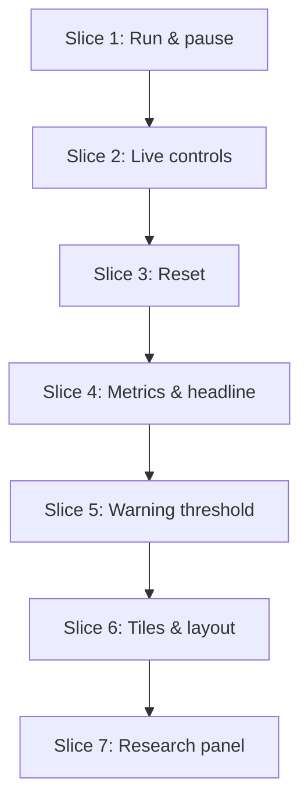

# Plan: AI vs. Human Code Review Simulator

**Created**: 2026-10-12 (rewritten after the research amendment; revised after plan review; revised for Vite build)
**Branch**: `feat/ai-review-sim`
**Status**: approved
**Gherkin persistence**: features
**Spec**: `docs/specs/ai-vs-human-code-review-simulator.md` (amended 2026-10-12)

## Goal

Build a Vite + React app whose `npm run build` output is one self-contained offline file, `dist/index.html`, that simulates a human lane and an AI lane of code review. The rules come from published research. PRs have a size in LOC. Human reviewers read at a set speed (LOC per work hour), and skim AI code faster. Defect catching falls past 200 LOC and past 500 LOC/hr. Escaped defects become incidents. With the defaults, the AI lane's queue explodes. A live headline readout shows AI incidents per PR at about 3.5× the human lane's. That ratio is an outcome of the model, not a hard-coded label. A collapsible panel presents the verified research with citations and states the modeling assumptions plainly. Vitest unit tests cover the pure engine. Playwright tests cover every user-visible behavior against the built page.

**Approach stances** (from `knowledge/decision-defaults.md`):

- **Scope:**
  - Create `src/engine.js`, `src/research.js`, `src/components/**`, and `e2e/*.spec.js`.
  - Replace the Vite demo (`src/App.jsx`, `src/App.css`, `src/assets/**`, `public/icons.svg`, the `src/index.js` starter and its test, `e2e/example.spec.js`).
  - Edit `vite.config.js`, `index.html`, `src/index.css`, `src/main.jsx`, `package.json` (feature dependencies only), and `CLAUDE.md` (page, commands, and talk note).
  - Do not touch `crt.html`, the `.mermaid` files, `sim.spec.md`, or the toolchain configs from project-init.
- **Integration:** commit on `feat/ai-review-sim`. Use a PR with auto-merge once a remote exists. Never merge directly to `main` without being asked.
- **Replace vs. merge:** the Vite demo files are scaffold placeholders and are replaced. Every other existing file is edited in place.

**Out of scope:** charts and history graphs, saving settings, backend, auth, runtime CDN loading of any kind, TypeScript, per-lane thresholds, separate reviewer pools per lane, hard-coding any research ratio (3×, 4.6×) into the math, and correcting tick timing for elapsed time.

## Preconditions (entry gate for `/build`)

- [x] `git init`, baseline commit `df30ed1` on `main`, branch `feat/ai-review-sim`.
- [x] Toolchain scaffolded by project-init (`83dbb30`). It provides:
  - Vite 8 and React 19.
  - oxlint, ESLint 9 (`lint:deep`), and Prettier.
  - Vitest, plus Playwright 1.64 with Chromium.
  - Husky with lint-staged.
  - All of `lint`, `lint:deep`, `format:check`, `test`, and `test:e2e` pass.

## Acceptance Criteria

From the amended spec:

- [ ] AC1: On page load, the simulation is paused and all counts show 0.
- [ ] AC2: Start begins the simulation. The button then reads Pause, and pressing it stops all count changes.
- [ ] AC3: Reset sets all counts and metrics to 0 and pauses. Slider values do not change.
- [ ] AC4: Each slider shows its value with units and uses the default, range, and step from the State table.
- [ ] AC5: After a slider change while running, the next tick's displayed counts reflect the new value, and the simulation keeps running.
- [ ] AC6: The warning-threshold slider (5–50, default 15) applies to both lanes.
- [ ] AC7: With the defaults, after 10 s:
  - Human: 0 pending, 10 deployed, 61%, 19 incidents, 1.95 per PR.
  - AI: 184 pending, 15 deployed, 10%, 107 incidents, 6.79 per PR, 116.0 h wait.
- [ ] AC7a: At the defaults, AI incidents per PR is 3×–4× human incidents per PR.
- [ ] AC7b: Defects caught follows the size and speed factors: 80% at PR size ≤ 200 (speed 300); 4% at PR size ≥ 400; 22% at PR size 200 and speed 900; AI lane 3% at skim 3×.
- [ ] AC7c: Changing PR size or reviewer speed while running changes defects caught and incident accrual from the next tick.
- [ ] AC8: A queue never shows a negative value.
- [ ] AC9: Deployed never decreases while running.
- [ ] AC10: Every count shows `Math.floor(x + 1e-9)` of its internal value (so 9.9999999999 shows 10, and 0.9 shows 0).
- [ ] AC11: A queue box warns when its displayed pending PRs are greater than the threshold, and clears at or below it. This applies to both lanes.
- [ ] AC12: The queue box shows `min(displayed, C)` tiles. C is exposed as `data-capacity`, between 22 and 98. When displayed > C, the box shows "+N more" with N = displayed − C.
- [ ] AC13: The Human lane has a blue `#3b82f6` accent, green Deployed, and `user`/`eye` icons. The AI lane has a purple `#a855f7` accent and `bot`/`eye` icons. The warning state is red `#ef4444`. At md (≥ 768px) and wider, each lane reads inputs → Pending Review → review side, left to right.
- [ ] AC14: The header shows "AI vs. Human Code Review Simulator" and "Watch AI-speed code generation swamp human reviewers and push more defects into production." At md and wider, the Start/Pause and Reset buttons sit to the right of the title. Below md, they sit on their own row.
- [ ] AC15: Page background `rgb(11, 13, 18)`. At 375 × 667 (below md = 768px), there is no horizontal scroll, the lanes stack, and Start/Pause and Reset are visible without scrolling. At 1280 × 720, the header, the headline, and both lanes' counts and metric grids are visible without scrolling.
- [ ] AC16: Sliders have visible labels, and every control works with the keyboard.
- [ ] AC17: Each lane shows pending LOC, "Defects caught" %, incidents, incidents per PR, and pickup wait.
- [ ] AC18: A collapsible research panel (collapsed by default) shows the five findings from the spec's Research Sources table. It uses the Panel wording column verbatim, except the practitioner-observation finding, which uses its quoted paraphrase. It links each source URL and never contains "near zero", "coined", or "originated".
- [ ] AC19: Hiding the tab while running auto-pauses the simulation.
- [ ] AC20 (revised): `npm run build` produces `dist/index.html` with no `<script src>`, no `<link rel="stylesheet">`, no `modulepreload`, and no `<link rel="icon">` pointing at a file. Opened from `file://`, it renders and runs and makes no request other than the document itself (`data:` URIs allowed). No page in any e2e spec requests an external host.
- [ ] AC21: A headline readout shows the live AI ÷ Human incidents-per-PR ratio (`toFixed(2)` + "×"), or "—" until both lanes *display* Deployed ≥ 1.
- [ ] AC22: An elapsed work-hours readout with a "1 s = 1 work hour" note, reset to 0.0 by Reset.

## Design decisions (fixed for the build)

### File structure and build

| Module | Contents |
|---|---|
| `src/engine.js` | Pure, with no React or DOM: constants, the numeric lane model (`sizeMultiplier`, `skimApplies`), the slider table (min/max/step/default), `sizeFactor`, `speedFactor`, `detection`, `laneParams`, `tick`, `isOverThreshold`, `emptyLane`, and the formatters. Unit-tested by `src/engine.test.js` (Vitest). An ESLint `no-restricted-imports` override forbids it from importing `react`, `lucide-react`, or `./components/*`. |
| `src/reducer.js` | Pure `reducer(state, action)` and `initialState`: `tick`, `start`, `pause`, `reset`, `setSetting`. Unit-tested by `src/reducer.test.js` (Vitest). |
| `src/laneConfig.js` | Presentation only: labels, icon names, and complete Tailwind class-string literals per lane. |
| `src/research.js` | The findings array and the assumptions text (data only). |
| `src/components/` | `Header`, `HeadlineBand`, `Lane`, `QueueBox`, `LaneMetrics`, `RateSlider`, `ResearchPanel`, and `Icon`. `Icon` maps an explicit set of five names (`user`, `bot`, `eye`, `triangle-alert`, `chevron-down`) to named `lucide-react` imports, never `icons[name]`, so tree-shaking keeps the bundle small. It adds the `data-icon` hook. |
| `src/App.jsx` | `useReducer(reducer, initialState)`, the interval and visibility effects, and the layout. |
| `src/main.jsx` | Mounts `App` and imports `index.css`, which holds the Tailwind 4 `@import "tailwindcss"` and the palette `@theme` tokens. |

**Build:**
- `vite.config.js` adds `@tailwindcss/vite` and `vite-plugin-singlefile`, so `npm run build` emits one `dist/index.html` with inlined JS and CSS.
- `index.html` gets the title "AI vs. Human Code Review Simulator". The `<link rel="icon" href="/favicon.svg">` is removed, and `public/` (favicon and icon sprites) is deleted, because nothing may be fetched besides the document.
- `playwright.config.js`: `reuseExistingServer: false`, so every e2e run builds fresh.
- `e2e/fixtures.js`: a shared Playwright `test` fixture that records every request on the page. After each test it asserts there were no external-host requests. For `file://` pages, the only allowed requests are the document URL plus `data:` and `blob:` URIs. Every spec imports `test`/`expect` from it.

**Feature dependencies** (exact versions recorded by `npm install` in `package-lock.json`):
- runtime: `lucide-react`
- dev: `tailwindcss` 4, `@tailwindcss/vite`, `vite-plugin-singlefile`

Step 1.1 asserts that the icons `User`, `Bot`, `Eye`, `TriangleAlert`, and `ChevronDown` exist in the installed `lucide-react`.

### State and engine

- **State:** one `useReducer` in `App` holds settings, both lanes, `ticks`, and `isRunning`. The interval depends only on `isRunning` and dispatches `{type:'tick'}`. The reducer reads the current settings, so AC5 and AC7c need no extra mechanism.
- **Settings:**
  - `humanGen` 1 (1–10)
  - `aiGen` 20 (5–50)
  - `prSize` 250 (50–1000, step 10)
  - `reviewerSpeed` 300 (100–1000, step 50)
  - `skim` 2 (1–3, step 0.5)
  - `threshold` 15 (5–50)
- **`laneParams(settings, laneCfg) → {gen, size, effSpeed}`** is the only place derived values come from. Lane config has `sizeMultiplier` (human 1, AI 1.51) and `skimApplies` (human false, AI true).
  - `size = round(prSize × sizeMultiplier)`
  - `effSpeed = reviewerSpeed × (skimApplies ? skim : 1)`
  - `tick`, `LaneMetrics`, and the read-only AI fields all use it.
- **Order inside `tick`:**
  1. Generate.
  2. Compute `avgSize = pendingPrs > 1e-9 ? pendingLoc / pendingPrs : size`.
  3. Compute `d = detection(avgSize, effSpeed)`.
  4. Review: `reviewedLoc = min(pendingLoc, effSpeed × 0.1)`, and `reviewedPrs = pendingLoc > 1e-9 ? pendingPrs × reviewedLoc / pendingLoc : 0`.
  5. Escape: add `reviewedLoc × 0.02 × (1 − d)`.
  6. Clamp pending to ≥ 0.
  7. `ticks += 1` (in the reducer).
- **Displayed "Defects caught"** uses `detection(size, effSpeed)` from the current settings, as the spec says. Accrual uses `avgSize`, so the two can differ briefly after a mid-run size change while the queue holds mixed sizes (see Risks).

### Display

- **Counts:** `floorShow(x) = Math.floor(x + 1e-9)`.
- **Defects caught:** `Math.round(d × 100)` + "%".
- **Incidents per PR:** `toFixed(2)`. Shows "—" while the *displayed* Deployed is 0.
- **Pickup wait:** `pendingLoc ÷ effSpeed`, shown with `toFixed(1)` + " h".
- **Pending LOC:** en-US thousands separators.
- **Headline:** `(aiEsc/aiDp) ÷ (humanEsc/humanDp)` from internal values, `toFixed(2)` + "×". Shows "—" until both lanes display Deployed ≥ 1.
- **Elapsed:** `(ticks × 0.1).toFixed(1)` + " work hours", with the caption "1 s = 1 work hour".
- **Warning:** the number, the tiles, and `isOverThreshold(displayed, threshold)` all use one `displayed` pending-PR value.

### Layout

**Header:**

- Title "AI vs. Human Code Review Simulator".
- Description, exact text: "Watch AI-speed code generation swamp human reviewers and push more defects into production."
- Start/Pause, Reset (with a visible gap from Start/Pause), the Running/Paused status, the elapsed readout, and the threshold slider.

**Headline band:** sits between the header and the lanes. It holds the large AI ÷ Human ratio with the text "more incidents per PR from AI-generated code".

**Lanes:** the Human lane is on top and the AI lane below, per spec §5. Each lane reads left → middle → right:

| Lane | Left | Middle | Right |
| --- | --- | --- | --- |
| **Human** | "Human generation (PRs/hr)" and "PR size (LOC, both lanes)" | Pending Review box (PRs + LOC) | "Reviewer speed (LOC/hr, both lanes)" and the metrics grid |
| **AI** | "AI generation (PRs/hr)" and derived text "PR size 378 LOC (×1.51)" | Pending Review box | "AI skim multiplier" slider, derived text "Effective speed 600 LOC/hr", and the metrics grid |

- Derived values are plain text with a small "derived" tag, never slider-styled.
- **Metrics grid:** identical in both lanes, with fixed row order: Deployed, Defects caught, Incidents, Incidents per PR, Pickup wait. It has the same column width in both lanes, so the rows line up vertically.

### Projector fit and type

At 1280 × 720 with the panel collapsed, the header, the headline band, and both lanes' Pending Review counts and metrics grids are visible without scrolling.

| Element | Minimum size |
| --- | --- |
| Headline ratio | `text-6xl` |
| Counts | `text-4xl` |
| Metric values | `text-xl` |
| Labels | `text-base` |

### Narrow layout (< `md`)

- The lanes stack.
- Inside a lane: inputs, then Pending Review, then the review side and metrics.
- The header wraps, with the buttons on their own row. They stay visible at 375 × 667.

### Look, accessibility, and test hooks

- **Palette:**
  - Human: blue accent `#3b82f6`, green Deployed.
  - AI: purple accent `#a855f7`.
  - Warning: red `#ef4444`.
  - Background `#0b0d12`.
- **Terminology:** "Pending Review", "Deployed", "Defects caught", "Incidents", "Incidents per PR", "Pickup wait".
- **Screen readers:** counts have no `aria-live`. A per-lane `role="status"` element announces only "<Lane> Pending Review over threshold".
- **Test hooks** (and nothing else): `data-lane="human|ai"`, `data-accent`, `data-icon="<name>"` on each `Icon`, `data-tile` on each tile, `data-metric="<name>"` on each metric value, `data-state="warning"`, and `data-capacity`.
  - Accent, warning, and focus colors are asserted through computed style.
  - The focus ring is asserted as a non-`none` `outline-style` on `:focus-visible`.

### Page behavior

- **Auto-pause:** a `visibilitychange` event with `visibilityState === 'hidden'` dispatches `pause`. Becoming visible again does nothing.
- **Research panel:** a `<details>`/`<summary>` element, collapsed by default.
  - Its text comes verbatim from the spec's Research Sources "Panel wording" column, with links to the five URLs (`target="_blank" rel="noopener"`).
  - It includes a "Model assumptions" note: defect density 20/KLOC, the 0.05 and 0.1 detection floors, the curve knees and walls, and the 1.51 size multiplier are modeling choices, calibrated so the defaults land near Faros's +242.7% incidents per PR.
  - The phrases "near zero", "coined", and "originated" never appear.

## Slices

Every slice edits `src/App.jsx` and `src/components/**`, so the slices run in sequence.

**Test approach (all slices):**

- **Engine (Vitest, `src/engine.test.js`):** every numeric scenario is first pinned as a pure-function test of `tick`, `detection`, and the formatters. This is fast and has no browser.
- **UI (Playwright, `e2e/*.spec.js`):**
  - Playwright's `webServer` builds and serves `dist/` (`vite preview`).
  - Each test calls `page.clock.install()` before `goto('/')`, waits for the header title, then calls `page.clock.pauseAt(now)`. Time then advances only through `runFor`; one tick is `runFor(100)`.
  - Tests find elements by role and accessible name, scoped by `data-lane`. They read visible text, ARIA attributes, the test hooks, or computed style.
- Slider labels below are the accessible names.

**Default arithmetic:**

- **Human:** +0.1 PR/tick, and review keeps up, so pending stays 0.
- **AI:** +2 PRs (756 LOC) per tick, reviewed 60 LOC = 0.15873 PR/tick, so pending grows by 1.84127 per tick.

The reference implementation is `scratchpad/check.py` and `check2.py`. Every number below was produced by it.

### Slice 1: Two lanes that run and pause

**Depends-on:** none
**Files:** `vite.config.js`, `index.html`, `package.json`, `package-lock.json`, `playwright.config.js`, `eslint.config.js`, `public/**`, `src/**`, `e2e/fixtures.js`, `e2e/run-pause.spec.js`, `e2e/example.spec.js`

**Behavior:**

```gherkin
Feature: Run and pause the simulation

  Scenario: Page loads paused with empty lanes
    Given I open the simulator
    Then both lanes show Pending Review 0 and Deployed 0
    And the Start/Pause button reads "Start"
    And the status reads "Paused"
    And the elapsed readout shows "0.0 work hours" with the caption "1 s = 1 work hour"

  Scenario: Header content
    Given I open the simulator
    Then the header shows the title "AI vs. Human Code Review Simulator"
    And the header shows "Watch AI-speed code generation swamp human reviewers and push more defects into production."
    And the Start/Pause and Reset buttons follow the title in reading order

  Scenario: Lane identity
    Given I open the simulator
    Then the Human lane has a "user" icon at generation, an "eye" icon at review, and a blue accent
    And the AI lane has a "bot" icon at generation, an "eye" icon at review, and a purple accent

  Scenario: Nothing moves while paused
    Given I open the simulator
    When 5 seconds pass without pressing Start
    Then both lanes still show Pending Review 0 and Deployed 0
    And the elapsed readout shows "0.0 work hours"

  Scenario: Start switches the button to Pause
    Given I open the simulator
    When I press Start
    Then the Start/Pause button reads "Pause" and the status reads "Running"

  Scenario: Default flow after 10 seconds
    Given I open the simulator
    When I press Start and 10 seconds pass
    Then the Human lane shows Pending Review 0 and Deployed 10
    And the AI lane shows Pending Review 184 and Deployed 15
    And the elapsed readout shows "10.0 work hours"

  Scenario: A PR is not shown as deployed until it is fully reviewed
    Given I open the simulator
    When I press Start and 0.9 seconds pass
    Then the Human lane shows Deployed 0
    When 0.1 more seconds pass
    Then the Human lane shows Deployed 1

  Scenario: Pause freezes the counts
    Given the simulation has run for 3 seconds
    When I press Pause and 5 more seconds pass
    Then the AI lane shows Pending Review 55 and Deployed 4
    And the elapsed readout shows "3.0 work hours"
    And the Start/Pause button reads "Start"

  Scenario: Resume continues from the frozen counts
    Given the simulation was paused after 3 seconds
    When I press Start and 1 second passes
    Then the AI lane shows Pending Review 73 and Deployed 6

  Scenario: Deployed never decreases while running
    Given I press Start
    Then each lane's Deployed count, sampled every tick for 10 seconds, never decreases

  Scenario: Hiding the tab auto-pauses
    Given the simulation has run for 1 second
    When the page becomes hidden
    And 3 seconds pass
    Then the status reads "Paused" and the AI lane still shows Pending Review 18

  Scenario: Showing the tab again stays paused
    Given the simulation auto-paused when the page became hidden
    When the page becomes visible again
    And 2 seconds pass
    Then the status reads "Paused" and the AI lane still shows Pending Review 18

  Scenario: Hiding the tab while paused changes nothing
    Given I open the simulator
    When the page becomes hidden
    Then the status reads "Paused" and all counts show 0

  Scenario: The build is one self-contained file
    Given the project is built
    Then dist/index.html exists
    And it has no script element with a src attribute, no stylesheet link, no modulepreload link, and no icon link to a file
    And dist contains no other JS or CSS files

  Scenario: The built file runs from disk with no other requests
    Given the project is built
    When I open dist/index.html from the file system
    Then the header title is visible
    When I press Start and 1 second passes
    Then the AI lane shows Pending Review 18
    And the only request made was for the document itself
```

**Steps:**

#### Step 1.1: Replace the Vite demo with the styled static shell and offline single-file build

**Complexity**: standard
**IMPLEMENT**:
- Remove the Vite demo and the starter placeholders: `src/App.css`, `src/assets/**`, `public/icons.svg`, `src/index.js`, `src/index.test.js`, and `e2e/example.spec.js`.
- Add `lucide-react`, `tailwindcss` 4, `@tailwindcss/vite`, and `vite-plugin-singlefile`. Configure `vite.config.js`.
- `src/index.css`: `@import "tailwindcss"` plus the palette `@theme` tokens. `index.html` gets the title.
- `src/engine.js`: lane config and `laneParams` only.
- Components: `Header` (title, exact description, Start/Pause, Reset, status, elapsed), `HeadlineBand` showing "—", two config-driven `Lane`s with test hooks, and `Icon` wrapping `lucide-react` with `data-icon`.
**TEST**:
- Vitest: `laneParams` at the defaults (human 250/300, AI 378/600).
- Playwright: page loads paused, header, lane identity, nothing moves while paused, and "the build is one self-contained file". The file is parsed for element attributes, not text-scanned for "http", which would false-fail on SVG `xmlns` and React strings. Add the shared `e2e/fixtures.js` external-request guard.
**REFACTOR**: Keep the numeric lane model and slider table in `src/engine.js`, and presentation config in `src/laneConfig.js`. The ESLint `no-restricted-imports` override keeps the engine pure.
**Files**: `vite.config.js`, `index.html`, `package.json`, `package-lock.json`, `playwright.config.js`, `eslint.config.js`, `public/**`, `src/**`, `e2e/fixtures.js`, `e2e/run-pause.spec.js`, `e2e/example.spec.js`
**Commit**: `feat(sim): offline single-file shell with paused lanes`

#### Step 1.2: Reducer, LOC-based tick, Start/Pause, and elapsed hours

**Complexity**: standard
**IMPLEMENT**:

- `src/reducer.js` (`initialState`, `start`/`pause`/`tick`) and the default settings (`laneParams` exists from Step 1.1).
- The pure `tick` with the full order above: generation, the avg-size guard, proportional review, and the clamp. Escape accrual is stubbed to `d = 0` until Step 4.2.
- The interval tied to `isRunning`, the Start/Pause toggle and status, `ticks`, and the elapsed readout.
**TEST**:
- Vitest:
  - `tick` default flow at 10 s (184/15, 0/10).
  - Partial PR asserted through `floorShow` after 9 and 10 accumulated ticks (0 and 1).
  - Clamp and empty-queue guard.
  - `reducer` start, pause, and tick (and ticks not advancing while paused).
- Playwright: Start→Pause, default flow at 10 s, partial PR, pause freeze, resume, deployed never decreases, and "the built file runs from disk with no other requests".
**REFACTOR**: Clear the interval on pause and on unmount. Keep the reducer cases small.
**Files**: `src/**`, `e2e/run-pause.spec.js`
**Commit**: `feat(sim): LOC-based tick engine with start/pause and elapsed hours`

#### Step 1.3: Auto-pause on hidden tab

**Complexity**: standard
**IMPLEMENT**: Add a `visibilitychange` listener that dispatches `pause` only when hidden. Remove the listener on unmount.
**TEST**: The three hidden/visible scenarios. Tests override `document.visibilityState` and dispatch the event.
**REFACTOR**: Group the effect hooks (interval, visibility) together.
**Files**: `src/**`, `e2e/run-pause.spec.js`
**Commit**: `feat(sim): auto-pause when the tab is hidden`

### Slice 2: Live controls

**Depends-on:** 1
**Files:** `src/**`, `e2e/controls.spec.js`

**Behavior:**

```gherkin
Feature: Adjust the model live

  Scenario Outline: Controls start at their defaults with units
    Given I open the simulator
    Then the "<control>" slider has value <default>, min <min>, max <max>, and step <step>
    And its visible value reads "<shown>"

    Examples:
      | control                              | default | min | max  | step | shown        |
      | Human generation (PRs/hr)            | 1       | 1   | 10   | 1    | 1 PRs/hr     |
      | AI generation (PRs/hr)               | 20      | 5   | 50   | 1    | 20 PRs/hr    |
      | PR size (LOC, both lanes)            | 250     | 50  | 1000 | 10   | 250 LOC      |
      | Reviewer speed (LOC/hr, both lanes)  | 300     | 100 | 1000 | 50   | 300 LOC/hr   |
      | AI skim multiplier                   | 2       | 1   | 3    | 0.5  | 2×           |

  Scenario: AI PR size and effective speed are derived and read-only
    Given I open the simulator
    Then the AI lane shows "PR size 378 LOC" and "Effective speed 600 LOC/hr", each marked "derived"
    And neither derived value is a slider
    When I set "PR size (LOC, both lanes)" to 200 and "AI skim multiplier" to 3
    Then the AI lane shows "PR size 302 LOC" and "Effective speed 900 LOC/hr"

  Scenario Outline: Sliders stop at their bounds
    Given I open the simulator
    When I press <key> 200 times on "<control>"
    Then the "<control>" slider has value <bound>

    Examples:
      | control                              | key        | bound |
      | AI generation (PRs/hr)               | ArrowRight | 50    |
      | AI generation (PRs/hr)               | ArrowLeft  | 5     |
      | Reviewer speed (LOC/hr, both lanes)  | ArrowLeft  | 100   |
      | AI skim multiplier                   | ArrowRight | 3     |

  Scenario: A review-side change applies on the next tick
    Given the simulation has run for 1 second with defaults
    And the AI lane shows Deployed 1
    When I set "Reviewer speed (LOC/hr, both lanes)" to 1000 and "AI skim multiplier" to 3
    And 0.1 seconds pass
    Then the AI lane shows Deployed 2
    And the Start/Pause button still reads "Pause"

  Scenario: A change while paused takes effect only after Start
    Given the simulation ran for 1 second and was paused
    And the AI lane shows Pending Review 18
    When I set "AI generation (PRs/hr)" to 50
    Then the AI lane still shows Pending Review 18
    When I press Start and 0.1 seconds pass
    Then the AI lane shows Pending Review 23

  Scenario: A backlog drains to zero and never below
    Given I set "Human generation (PRs/hr)" to 10 and the simulation has run for 2 seconds
    And the Human lane shows Pending Review 17
    When I set "Human generation (PRs/hr)" to 1 and "Reviewer speed (LOC/hr, both lanes)" to 1000
    And 6 seconds pass
    Then the Human lane shows Pending Review 0
    And the Human Pending Review count, sampled every tick, was never below 0

  Scenario: Sliders are keyboard operable
    Given I open the simulator
    When I Tab to "Reviewer speed (LOC/hr, both lanes)" and press ArrowRight
    Then that slider has value 350 and its visible value reads "350 LOC/hr"
```

**Steps:**

#### Step 2.1: Labeled sliders, derived AI values, and live/paused changes

**Complexity**: standard
**IMPLEMENT**:

- Add a `RateSlider` component: a native range input, a `<label>` (the accessible name above), a visible value with units, and `aria-valuetext` with units.
- Add the five sliders in their lane positions.
- Add the derived AI text from `laneParams`.
**TEST**: All seven scenarios. The engine needs no change, because the reducer already reads the current settings.
**REFACTOR**: Slider config comes from one table, matching the spec's State table.
**Files**: `src/**`, `e2e/controls.spec.js`
**Commit**: `feat(sim): live model controls with derived AI size and speed`

> Check: paused at 1 s, AI pending is 18.41 PRs. With `aiGen` 50, one tick adds 5 and reviews 0.159, giving 23.25, which displays 23.

### Slice 3: Reset

**Depends-on:** 2
**Files:** `src/**`, `e2e/reset.spec.js`

**Behavior:**

```gherkin
Feature: Reset the simulation

  Scenario: Reset while running clears lanes and elapsed time, pauses, and keeps settings
    Given I set "AI generation (PRs/hr)" to 40 and "PR size (LOC, both lanes)" to 300
    And the simulation is running and has run for 3 seconds
    When I press Reset
    Then both lanes show Pending Review 0 and Deployed 0
    And the elapsed readout shows "0.0 work hours"
    And the Start/Pause button reads "Start"
    And "AI generation (PRs/hr)" has value 40 and "PR size (LOC, both lanes)" has value 300

  Scenario: Reset while paused with non-zero counts clears them
    Given the simulation ran for 3 seconds and was paused
    When I press Reset
    Then both lanes show Pending Review 0 and Deployed 0

  Scenario: Counts stay at zero after Reset
    Given I pressed Reset while running
    When 5 seconds pass
    Then both lanes still show Pending Review 0 and Deployed 0

  Scenario: Reset on a fresh page changes nothing
    Given I open the simulator
    When I press Reset
    Then both lanes show Pending Review 0 and Deployed 0 and the Start/Pause button reads "Start"

  Scenario: Start after Reset runs from zero with the kept settings
    Given I set "AI generation (PRs/hr)" to 40 and pressed Reset
    When I press Start and 1 second passes
    Then the AI lane shows Pending Review 38 and Deployed 1

  Scenario: Reset is keyboard operable
    Given the simulation has run for 1 second
    When I Tab to "Reset" and press Enter
    Then both lanes show Pending Review 0 and Deployed 0
```

**Steps:**

#### Step 3.1: Reset button

**Complexity**: standard
**IMPLEMENT**: Add a `reset` reducer case. It sets both lanes to `emptyLane`, `ticks` to 0, and `isRunning` to false. Settings are untouched.
**TEST**: All six scenarios.
**REFACTOR**: Share `emptyLane` between the initial state and reset.
**Files**: `src/**`, `e2e/reset.spec.js`
**Commit**: `feat(sim): reset clears lanes and pauses`

### Slice 4: Quality metrics and headline ratio

**Depends-on:** 3
**Files:** `src/**`, `e2e/metrics.spec.js`

**Behavior:**

```gherkin
Feature: Review quality metrics

  Scenario: Defects caught and pending LOC at rest
    Given I open the simulator
    Then the Human lane shows Defects caught 61% and Pending LOC 0
    And the AI lane shows Defects caught 10% and Pending LOC 0

  Scenario Outline: Defects caught follows PR size
    Given I set "PR size (LOC, both lanes)" to <size>
    Then the Human lane shows Defects caught <caught>

    Examples:
      | size | caught |
      | 50   | 80%    |
      | 200  | 80%    |
      | 300  | 42%    |
      | 400  | 4%     |
      | 1000 | 4%     |

  Scenario Outline: Defects caught follows reviewer speed
    Given I set "PR size (LOC, both lanes)" to 200 and "Reviewer speed (LOC/hr, both lanes)" to <speed>
    Then the Human lane shows Defects caught <caught>

    Examples:
      | speed | caught |
      | 500   | 80%    |
      | 750   | 44%    |
      | 900   | 22%    |
      | 1000  | 8%     |

  Scenario: Skimming harder lowers AI defects caught
    Given I set "AI skim multiplier" to 3
    Then the AI lane shows Defects caught 3%

  Scenario: Reviewing AI code at human pace restores some catching
    Given I set "AI skim multiplier" to 1
    Then the AI lane shows Defects caught 12%

  Scenario: Incident metrics at rest
    Given I open the simulator
    Then both lanes show Incidents 0, Incidents per PR "—", and Pickup wait 0.0 h
    And the headline ratio shows "—"

  Scenario: Default metrics after 10 seconds
    Given I open the simulator
    When I press Start and 10 seconds pass
    Then the Human lane shows Incidents 19, Incidents per PR 1.95, Pickup wait 0.0 h
    And the AI lane shows Incidents 107, Incidents per PR 6.79, Pickup wait 116.0 h, Pending LOC 69,600
    And the headline ratio shows "3.48×"

  Scenario: The research effect emerges at the defaults
    Given the simulation has run for 10 seconds with defaults
    Then the headline ratio is between 3 and 4

  Scenario: Incidents per PR waits for a whole deployed PR
    Given I open the simulator
    When I press Start and 0.9 seconds pass
    Then the Human lane shows Deployed 0 and Incidents per PR "—"
    And the headline ratio shows "—"
    When 0.1 more seconds pass
    Then the Human lane shows Deployed 1 and Incidents per PR 1.95

  Scenario: Larger PRs accrue more incidents
    Given I set "PR size (LOC, both lanes)" to 400
    When I press Start and 10 seconds pass
    Then the Human lane shows Pending Review 2, Deployed 7, Incidents 57, and Incidents per PR 7.68

  Scenario: A size change while running changes defects caught and accrual on the next tick
    Given the simulation has run for 1 second with defaults
    When I set "PR size (LOC, both lanes)" to 400
    And 0.1 seconds pass
    Then the Human lane shows Defects caught 4%
    When 8.9 more seconds pass
    Then the Human lane shows Incidents 53 and Incidents per PR 6.94

  Scenario: Queued PRs keep their size when PR size changes
    Given I set "Human generation (PRs/hr)" to 10 and the simulation has run for 2 seconds
    And the Human lane shows Pending Review 17 and Pending LOC 4,400
    When I pause, set "PR size (LOC, both lanes)" to 500, and press Start
    And 1 second passes
    Then the Human lane shows Pending Review 26 and Pending LOC 9,100

  Scenario: A drained queue shows no wait
    Given I set "Human generation (PRs/hr)" to 10 and the simulation has run for 2 seconds
    When I set "Human generation (PRs/hr)" to 1 and "Reviewer speed (LOC/hr, both lanes)" to 1000
    And 6 seconds pass
    Then the Human lane shows Pending Review 0, Pickup wait 0.0 h, and Defects caught 6%

  Scenario: Incidents never decrease while running
    Given I press Start
    Then each lane's Incidents count, sampled every tick for 10 seconds, never decreases

  Scenario: Reset clears the metrics
    Given the simulation has run for 10 seconds
    When I press Reset
    Then both lanes show Incidents 0, Incidents per PR "—", and Pickup wait 0.0 h
    And the headline ratio shows "—"
```

**Steps:**

#### Step 4.1: Detection functions and "Defects caught" display

**Complexity**: standard
**IMPLEMENT**: Add the pure `sizeFactor`, `speedFactor`, and `detection` functions. Add the `LaneMetrics` grid (fixed row order), showing Defects caught from `laneParams` and Pending LOC.
**TEST**:
- Vitest: `sizeFactor`, `speedFactor`, and `detection` table values (80/80/42/4/4, 80/44/22/8, AI 3/12, drained-queue display 6%).
- Playwright: defects caught at rest, both outlines, the two skim scenarios.
**REFACTOR**: Name the curve constants: `SIZE_KNEE=200`, `SIZE_WALL=400`, `SIZE_FLOOR=0.05`, `SPEED_KNEE=500`, `SPEED_WALL=1000`, `SPEED_FLOOR=0.1`, `BASE_DETECTION=0.8`, `DEFECTS_PER_LOC=0.02`.
**Files**: `src/**`, `e2e/metrics.spec.js`
**Commit**: `feat(sim): defects-caught rate from PR size and reviewer speed`

#### Step 4.2: Incidents, pickup wait, and the headline ratio

**Complexity**: standard
**IMPLEMENT**:

- Replace the `d = 0` stub with real escape accrual.
- Display Incidents, Incidents per PR (with the "—" rule), and Pickup wait (`pendingLoc ÷ effSpeed`).
- Add the headline-band ratio.
**TEST**: Vitest pins escape accrual (19/1.95, 107/6.79, 57/7.68, 53/6.94, ratio 3.48), with incidents per PR divided by *internal* Deployed (107.84 / 15.87, not 107 / 15), and pickup wait (116.0). Playwright covers incident metrics at rest, default metrics at 10 s, the research effect, the "—" rule, larger PRs, the mid-run size change, queued sizes kept, drained queue, incidents never decrease, reset clears.
**REFACTOR**: Keep the formatters (`floorShow`, `pct`, `perPr`, `hours`, `loc`, `ratio`) in `src/engine.js`.
**Files**: `src/**`, `e2e/metrics.spec.js`
**Commit**: `feat(sim): incidents, pickup wait, and live AI-vs-human ratio`

### Slice 5: Warning threshold

**Depends-on:** 4
**Files:** `src/**`, `e2e/warning.spec.js`

**Behavior:**

```gherkin
Feature: Pending Review overload warning

  Scenario: AI queue turns red once it exceeds the default threshold
    Given I open the simulator
    When I press Start and 0.8 seconds pass
    Then the AI lane shows Pending Review 14 and is not in the warning state
    When 0.1 more seconds pass
    Then the AI lane shows Pending Review 16 and is in the warning state
    And the AI queue box shows a "triangle-alert" icon and a red border
    And a status message announces "AI Pending Review over threshold"
    And the Human lane is not in the warning state

  Scenario: Displayed value at the threshold is not a warning even if the internal value is above it
    Given I set "Human generation (PRs/hr)" to 10
    When I press Start and 1.8 seconds pass
    Then the Human lane shows Pending Review 15 and is not in the warning state
    When 0.1 more seconds pass
    Then the Human lane shows Pending Review 16 and is in the warning state

  Scenario: A custom threshold applies to both lanes
    Given I set "Human generation (PRs/hr)" to 10 and the simulation ran for 2 seconds and was paused
    And the Human lane shows Pending Review 17 and the AI lane shows Pending Review 36
    When I set "Warning threshold" to 17
    Then the Human lane is not in the warning state and the AI lane is in the warning state
    When I set "Warning threshold" to 16
    Then both lanes are in the warning state

  Scenario: Exactly at a custom threshold is not a warning
    Given I set "Warning threshold" to 18
    When I press Start and 1 second passes
    Then the AI lane shows Pending Review 18 and is not in the warning state

  Scenario: Raising the threshold while paused clears the warning
    Given the simulation ran for 1.2 seconds and was paused
    And the AI lane shows Pending Review 22 and is in the warning state
    When I set "Warning threshold" to 25
    Then the AI lane is not in the warning state

  Scenario: Lowering the threshold while running applies immediately
    Given the simulation has run for 0.5 seconds
    And the AI lane shows Pending Review 9 and is not in the warning state
    When I set "Warning threshold" to 5
    Then the AI lane is in the warning state

  Scenario: Warning clears when the queue drains to the threshold
    Given I set "Human generation (PRs/hr)" to 10 and the simulation has run for 2 seconds
    And the Human lane shows Pending Review 17 and is in the warning state
    When I set "Human generation (PRs/hr)" to 1 and "Reviewer speed (LOC/hr, both lanes)" to 1000
    And 0.5 seconds pass
    Then the Human lane shows Pending Review 16 and is in the warning state
    When 0.1 more seconds pass
    Then the Human lane shows Pending Review 15 and is not in the warning state

  Scenario: Threshold slider default and bounds
    Given I open the simulator
    Then "Warning threshold" has value 15, min 5, max 50, and step 1

  Scenario: Reset keeps the threshold
    Given I set "Warning threshold" to 30
    When I press Reset
    Then "Warning threshold" has value 30
```

**Steps:**

#### Step 5.1: Global threshold and warning state

**Complexity**: standard
**IMPLEMENT**: Add the threshold slider to the header. The `QueueBox` warning state applies a red border and background, a `TriangleAlert` icon, `data-state="warning"`, and the lane's `role="status"` message. All of it is driven by `isOverThreshold(displayed, threshold)`.
**TEST**: All nine scenarios. The red border is asserted through computed `border-color` `rgb(239, 68, 68)`.
**REFACTOR**: `isOverThreshold` is the only place the comparison is made.
**Files**: `src/**`, `e2e/warning.spec.js`
**Commit**: `feat(sim): adjustable warning threshold for both lanes`

### Slice 6: Tiles, overflow, and layout

**Depends-on:** 5
**Files:** `src/**`, `e2e/tiles.spec.js`, `e2e/layout.spec.js`

**Behavior:**

```gherkin
Feature: Pending Review tiles and layout

  Background:
    Given the queue tile capacity C is read from the queue box

  Scenario: One tile per pending PR
    Given I open the simulator
    When I press Start and 1.2 seconds pass
    Then the AI lane shows Pending Review 22, 22 tiles, and no overflow indicator

  Scenario: Empty queue shows no tiles
    Given I open the simulator
    Then neither Pending Review box shows any tiles

  Scenario: Exactly at capacity has no overflow indicator
    Given I set "Human generation (PRs/hr)" to 10, "PR size (LOC, both lanes)" to 1000, and "Reviewer speed (LOC/hr, both lanes)" to 100
    When I press Start and advance one tick at a time until the Human lane shows Pending Review C
    Then the Human lane shows C tiles and no overflow indicator
    When 0.1 more seconds pass
    Then the Human lane shows C tiles and the text "+1 more"

  Scenario: Overflow beyond capacity
    Given I open the simulator
    When I press Start and 10 seconds pass
    Then the AI lane shows C tiles and the text "+N more", where N is 184 minus C

  Scenario: Projector fit at 1280 × 720
    Given the viewport is 1280 × 720 and the simulation has run for 10 seconds
    Then the header, the headline ratio, and both lanes' Pending Review counts and metric grids are fully visible without scrolling

  Scenario: Metric rows line up across lanes
    Given the viewport is 1280 × 800
    Then each metric row in the Human lane has the same left edge as the matching row in the AI lane

  Scenario: No horizontal scroll on a phone, even when overflowing
    Given the viewport is 375 × 667
    When I press Start and 10 seconds pass
    Then the AI lane shows a "+N more" indicator
    And the page does not scroll horizontally
    And the two lanes are stacked one above the other
    And within each lane the inputs, the Pending Review box, and the review side appear top to bottom
    And the Start/Pause and Reset buttons are visible without scrolling

  Scenario: Wide layout reads left to right
    Given the viewport is 1280 × 800
    Then within each lane the inputs, the Pending Review box, and the review side appear left to right
    And the Start/Pause and Reset buttons sit to the right of the title

  Scenario: Dark theme
    Given I open the simulator
    Then the page background color is rgb(11, 13, 18)

  Scenario: Every control is keyboard reachable with a visible focus ring
    Given I open the simulator
    When I Tab through the page
    Then focus visits Start, Reset, the threshold slider, and all five model sliders
    And each has an accessible name and a non-none outline when focused
```

**Steps:**

#### Step 6.1: Tile grid and "+N more"

**Complexity**: standard
**IMPLEMENT**: `QueueBox` renders `min(displayed, TILE_CAPACITY)` `aria-hidden` tiles, each with `data-tile`, plus "+N more", and exposes `data-capacity`. `TILE_CAPACITY` must be between 22 and 98 and fit at 375px.
**TEST**: The four tile scenarios (tiles counted by `[data-tile]`).
**REFACTOR**: Keep tile rendering a pure function of `displayed` and capacity.
**Files**: `src/**`, `e2e/tiles.spec.js`
**Commit**: `feat(sim): queue tiles with overflow indicator`

> Check: with Human generation 10, PR size 1000, and speed 100, the lane displays n−1 after n ticks, so it hits every integer up to 99.

#### Step 6.2: Projector fit, aligned metrics, responsive layout, and focus

**Complexity**: standard
**IMPLEMENT**: The type scale, the compact lane layout for 1280 × 720, the fixed-width metrics column, narrow stacking, header wrapping, and `:focus-visible` outlines.
**TEST**: Projector fit, rows aligned, phone, wide, dark theme, keyboard and focus.
**REFACTOR**: Consolidate the color tokens in lane config. Remove dead class strings.
**Files**: `src/**`, `e2e/layout.spec.js`
**Commit**: `feat(sim): projector-fit responsive layout with aligned metrics`

### Slice 7: Research panel and docs

**Depends-on:** 6
**Files:** `src/**`, `e2e/research.spec.js`, `e2e/layout.spec.js`, `CLAUDE.md`

**Behavior:**

```gherkin
Feature: Research behind the simulation

  Scenario: Panel is collapsed by default
    Given I open the simulator
    Then the "Research behind this simulation" toggle is collapsed
    And no research findings are visible

  Scenario: Expanding shows every finding verbatim with its source
    Given I open the simulator
    When I expand "Research behind this simulation"
    Then the panel contains "2,500 reviews of 3.2 million lines of code over 10 months"
    And the panel contains "Review no more than 200–400 LOC at a time"
    And the panel contains "faster than 500 LOC/hour"
    And the panel contains "PR size +51%" and "(+242.7%)"
    And the panel contains "AI PRs wait 4.6× longer before review, but are reviewed 2× faster once picked up"
    And the panel contains "practitioner observation" and "locally coherent but globally brittle"
    And the panel links to all five source URLs from the spec's Research Sources table, each opening in a new tab

  Scenario: Unsupported or misattributing wording never appears
    Given I expand "Research behind this simulation"
    Then the page does not contain "near zero", "coined", or "originated"

  Scenario: Model assumptions and calibration are stated
    Given I expand "Research behind this simulation"
    Then the panel states that defect density, the detection floors, the curve thresholds, and the 1.51 size multiplier are modeling choices
    And the panel states that the defaults were calibrated to land near Faros's +242.7% incidents per PR

  Scenario: Panel is keyboard operable and does not interrupt the simulation
    Given the simulation is running
    When I Tab to the research toggle and press Enter
    Then the panel expands and the status still reads "Running"

  Scenario: Panel fits a phone
    Given the viewport is 375 × 667
    When I expand "Research behind this simulation"
    Then the page does not scroll horizontally
```

**Steps:**

#### Step 7.1: Collapsible research panel

**Complexity**: standard
**IMPLEMENT**: Add a `ResearchPanel` (`<details>`/`<summary>`) below the lanes, rendered from `src/research.js` (spec Panel wording, URLs, and the assumptions/calibration note). Add the toggle to the Slice 6 Tab-order test.
**TEST**: All six scenarios, plus the updated keyboard scenario.
**REFACTOR**: Keep the findings as data, separate from the markup.
**Files**: `src/**`, `e2e/research.spec.js`, `e2e/layout.spec.js`
**Commit**: `feat(sim): collapsible research panel with verified citations`

#### Step 7.2: Document the page in CLAUDE.md

**Complexity**: trivial
**IMPLEMENT**: Add to `CLAUDE.md`:
- The app layout and the commands: `npm run dev`, `npm run build` (gives `dist/index.html`), `npm test`, `npx vitest run src/engine.test.js -t <name>`, `npm run test:e2e`, `npx playwright test e2e/<file>`, `npm run lint`, and `npm run format:check`.
- A pointer to the spec for the model.
- A talk note: present from the built `dist/index.html`, which works offline. Re-check the research URLs before major talks.
**TEST**: The full suite stays green.
**REFACTOR**: Keep the file list in `CLAUDE.md` consistent with the folder.
**Files**: `CLAUDE.md`
**Commit**: `docs: add simulator page, test commands, and pre-talk check to CLAUDE.md`

## Parallelization



| Wave | Slices (parallel) |
| ------ | ------------------- |
| 1 | 1 |
| 2 | 2 |
| 3 | 3 |
| 4 | 4 |
| 5 | 5 |
| 6 | 6 |
| 7 | 7 |

The slices run in sequence on purpose: every slice edits `src/App.jsx` and `src/components/**`. The minimum viable demo is Slices 1–5 plus 7. Don't drop Slice 7 as "last": the cited research is a core requirement.

## Complexity Classification

| Rating | Criteria | Review depth |
| -------- | ---------- | -------------- |
| `trivial` | Single-file rename, config change, typo fix, documentation-only | Skip inline review; covered by final `/code-review` |
| `standard` | New function, test, module, or behavioral change within existing patterns | Spec-compliance + relevant quality agents |
| `complex` | Architectural change, security-sensitive, cross-cutting concern, new abstraction | Full agent suite including opus-tier agents |

## Pre-PR Quality Gate

- [ ] Unit tests pass (`npm test`)
- [ ] E2E tests pass (`npm run test:e2e`)
- [ ] Lint passes (`npm run lint` and `npm run lint:deep`)
- [ ] Formatting passes (`npm run format:check`)
- [ ] Type check: n/a (JavaScript)
- [ ] `npm run build` produces a single `dist/index.html`
- [ ] `/code-review` passes
- [ ] `CLAUDE.md` updated (Step 7.2)

## Skipped (low value)

| Finding | Rationale (one line) |
| --- | --- |
| Memoize the tile array | Tiles are capped at C, so the render cost is bounded and there's no observable behavior to test. |
| `@axe-core/playwright` scan | Not requested. AC16 is covered by the keyboard, accessible-name, and focus scenarios. |
| Test that a queue never shows a negative value (direct) | `floorShow` and the clamp make a negative value unobservable. AC8 is covered by the drain scenarios sampling every tick. |

## Risks & Open Questions

- **Model calibration is sensitive.** Changing the curve constants moves the 3.48× ratio. AC7a (3×–4×) guards the research story. The exact-number scenarios guard the formulas.
- **Defects caught (display) vs. accrual.** The display uses the current settings. Accrual uses the average pending PR size. After a mid-run size change, the two can differ until the mixed-size queue drains. This is accepted, because the spec defines the display that way.
- **Projector fit at 1280 × 720 is tight.** The header, headline, two lanes, tiles, and metric grids must all fit. Step 6.2 may need a smaller tile size or a two-column header. If it can't fit, the fallback is to shrink tiles before cutting any metric.
- **Tailwind 4 differences.** The config is CSS-first (`@theme`) and some utilities were renamed from v3. Step 1.1 establishes the palette tokens. Class strings must stay complete literals so Tailwind's scanner finds them.
- **Single-file inlining.** `vite-plugin-singlefile` must inline everything. The offline scenario and the external-URL check in Step 1.1 guard this.
- **Fake clock vs. React scheduler.** Step 1.1 checks this first. The fallback is `install({ shouldAdvanceTime: false })` after render.
- **Build-before-e2e time.** With `reuseExistingServer: false`, Playwright's `webServer` rebuilds every run, which adds a few seconds. That's acceptable.
- **Research figures drift.** The panel quotes sources as of 2026-10-12.

## Plan Review Summary

**Plan tier: complex** (7 waves, 7 slices). Reviewers: Acceptance, Design, UX, Strategic, Parallelization (all 5).

| Reviewer | Round 1 (rewritten plan) | Outcome |
| --- | --- | --- |
| Acceptance | needs-revision (2 blockers, 9 warnings) | Round 2: **approve** (2 warnings, folded in) |
| Design | approve (2 warnings) | Folded in |
| UX | needs-revision (4 warnings, 0 blockers) | Folded in |
| Strategic | approve (2 warnings) | Folded in |
| Parallelization | approve | n/a |

**Folded in:**

- **Accrual test:** incident accrual is now tested after a size change (53 incidents, 6.94 per PR).
- **Custom threshold:** now tested on both lanes (Human 17 / AI 36).
- **Mixed PR sizes:** tested through Pending Review 26 / LOC 9,100.
- **"—" rule:** applies to displayed Deployed.
- **Average-size guard:** no division by zero on an empty queue.
- **Per-host CDN failures:** each library's failure was tested. *Superseded by the Vite build revision: no runtime CDNs remain.*
- **Verbatim research wording:** the panel's strings and links are checked exactly.
- **Boundary tests:** the "+1 more" boundary, a speed-900 detection row (22%), visible-again-stays-paused, the exact header description, and slider value/attribute assertions.
- **Test hooks:** explicit hooks plus computed-style checks for colors and focus.
- **Engine structure:** the single `laneParams` and the tick order. *The script regions, SRI hashes, and CDN pins were superseded by the Vite build revision: modules plus `package-lock.json`.*
- **Your decisions:** the hero ratio readout, the elapsed work hours readout, the "Defects caught" label, and the pickup-wait formula. All are recorded in the spec.
- **Lane layout:** aligned metric grids, "(both lanes)" labels, projector fit at 1280×720, and a gap between Start/Pause and Reset.
- **Assumptions note:** the panel now states the calibration plainly.
- **Talk prep:** a pre-talk note. *Superseded: the offline `dist/index.html` removes the CDN risk.*

## Vite build revision (2026-10-12, during /build)

At the build's project-init gate, you chose a build step instead of the single-HTML/CDN delivery. Your decisions:
- Vite + React (JSX).
- A single offline `dist/index.html` (`vite-plugin-singlefile`).
- AC20 and every CDN item dropped.
- Tailwind 4 via `@tailwindcss/vite`.

**Behavior is unchanged.** Every scenario and number stays the same, except that Slice 1's failed-script outline is replaced by two build-output scenarios. Engine numbers are now also pinned in Vitest.

**Revision review:**
- **Design** (needs-revision, 5 warnings, folded in): `laneConfig.js` split plus the engine import rule, the pure `reducer.js`, `reuseExistingServer: false`, the favicon and `public/` removal, and an explicit icon map.
- **Acceptance** (1 blocker, fixed; re-check approved): the single-file build scenario, plus the `file://` run, the shared external-request fixture, the split of the offline check between Steps 1.1 and 1.2, and the `floorShow` and internal-Deployed notes.

## Build Progress

### Slices (grouped by wave)

#### Wave 1

- [x] Slice 1: Two lanes that run and pause
  - [x] Step 1.1: Replace the Vite demo with the styled static shell and offline single-file build
  - [x] Step 1.2: Reducer, LOC-based tick, Start/Pause, and elapsed hours
  - [x] Step 1.3: Auto-pause on hidden tab

#### Wave 2

- [x] Slice 2: Live controls
  - [x] Step 2.1: Labeled sliders, derived AI values, and live/paused changes

#### Wave 3

- [x] Slice 3: Reset
  - [x] Step 3.1: Reset button

#### Wave 4

- [x] Slice 4: Quality metrics and headline ratio
  - [x] Step 4.1: Detection functions and "Defects caught" display
  - [x] Step 4.2: Incidents, pickup wait, and the headline ratio

#### Wave 5

- [x] Slice 5: Warning threshold
  - [x] Step 5.1: Global threshold and warning state

#### Wave 6

- [ ] Slice 6: Tiles, overflow, and layout
  - [ ] Step 6.1: Tile grid and "+N more"
  - [ ] Step 6.2: Projector fit, aligned metrics, responsive layout, and focus

#### Wave 7

- [ ] Slice 7: Research panel and docs
  - [ ] Step 7.1: Collapsible research panel
  - [ ] Step 7.2: Document the page in CLAUDE.md
